# R1 走查报告：AI Tutor（staging 对 PRD 与设计稿）

> 日期：2026-11-13（11-16 补验证链接并复核） · 轮次：R1 · 配套清单：`R1_修改清单.md`（51 条，下文 “#n” 指清单行号）
> 框架：`00_走查清单框架.md`。A 轨对 PRD，B 轨对规范；结论分 **已确认 / 设计判断 / 需用户确认**。

## 结论

staging 上 AI Tutor 老师端主流程都能走通，没有报错或卡死：Dashboard 入口 → 创建向导 → Task Detail → Assign → Monitor → Student Detail → Preview，以及 Reading Screener 推荐面板 → Quick Assign。问题集中在“没跟上 PRD 最近几次修订”，不是功能坏了。

一共记了 51 条：

| 类型 | 条数 | 说明 |
| --- | --- | --- |
| 已确认 | 34 | staging 和 PRD（或已确认的产品规则）明确不一致，可以直接提给前端 |
| 设计判断 | 7 | PRD 没写死，按设计经验提的改法 |
| 需用户确认 | 10 | 要用户或 PM 先拍板，清单里状态为“搁置” |

其中 46 条是 staging 的问题，5 条（#9、#48–#51）是设计稿自己落后于 PRD，要在 Figma 里改。

最要紧的 5 件事：

1. **Monitor 没有状态筛选**（#31）。PRD §5.2 要六项筛选，设计稿也画了，staging 完全没有。
2. **Preview Task 和学生端不一样**（#43–#45）。没有学生顶栏和 “Step N of M”，“Exit Preview” 在右上角而不是替换左上 Home；准备页还写着 “Your reading is recorded for your teacher.”，和“预览不存数据”矛盾。
3. **Student Detail 文案还是原型版**（#36–#41）。教师标注仍是 “Needs support / Unclear”（已定为 “Still needs support / Can't tell”），证据分组标题带次数，返回和翻页按钮文案不对，有 Kira 提示的学生看不到 What Kira said today。
4. **11-05 改名没落地**（#1、#3）。类型下拉、创建页类型卡、Quick Assign、已分配提示都还叫 “Screener”，应为 “Reading Screener”。
5. **创建向导 Step 1 没按 11-05 版改**（#10–#15）。Task Type 不在第一位；AI Tutor 步骤卡阶段名、时长格式不对，缺 Session Type（Phonics Preview）和 “Fixed sequence”。

## 范围、基准和方法

- **staging**：`staging.kira-learning.com/ai-tools/literacy-studio/`。账号默认 Admin 角色进 Literacy Studio 会 403，本轮切到 Teacher 角色（William C. Overfelt High School）走查，结束后已切回 Admin。用的是 staging 上已有的 QA 测试任务（`QA-AIT-20261104-*`、`QA-AIT-20261105-EX-G3-*` 等）。本轮没有保存新任务（向导走到 Step 3 后弃稿），Remove / End 弹窗只打开看文案，都点了 Cancel。
- **PRD**：Notion 上的 Teacher View 与 Student View，读取时为最新版（含 11-05、11-06、11-08、11-10 修订）。
- **设计稿**：Figma `pCdwCN68j1KGXz3aZZ6Wn0` 各 section 的 Latest 列：Monitor `1925:10702`、Student Detail `286:18332`、Quick Assign `1925:31830`、Create task – Latest `1947:12808`、Task details `1925:16759`。节点对照见 `需求文档/00_PRD溯源.md`。
- **判断顺序**：按 `AGENTS.md`，用户指令 > PRD > `需求文档/01_产品规则.md` > 本地文档 > 通用判断。老师端 Monitor 和 Student Detail 两边不一致时按 PRD（用户 2026-11-12）。以下几条产品规则是 PRD 的已知例外，按规则判：Assign 弹窗约 1000px 双栏、Task Detail 主按钮 “+ Assign to Students”、Preview 不加预览条并把 Home 换成 “← Exit Preview”、教师标注文案 “Read it / Still needs support / Can't tell”、Quick Assign 默认 Scheduled 且只选日期。
- **方法**：用 Chrome 无头浏览器逐屏截图并读取页面文字和悬停提示，和 PRD 原文、Figma Latest 帧逐项对照。

## 根因

1. **设计稿落后于 PRD**。10-24（学生顶栏）、10-25（AI Insights 移到 Phase 2、不显示 Primary Reading Objective、删 T8 常驻说明）、11-05（改名、Step 1 字段顺序）这几轮改动，很多没进 Figma 的 Latest 帧（#9、#48–#51）。前端照稿做就会做成旧版，比如 Step 1 字段顺序（#10）。
2. **前端文案沿用原型 PR #27776**。标注按钮、返回按钮、翻页按钮、“Open response” 都和原型一致、和 PRD 不一致（#36–#41）。2026-11-12 规则改成“两边不一致时按 PRD”，前端还没跟上。
3. **改名只改了文档**。11-05 把 Screener 改为 Reading Screener，界面字符串没有统一替换，散在至少 5 个地方（#1、#3）。
4. **共用 V1 外壳沿用生产命名**。Dashboard、All Tasks、Task Detail、Assign 弹窗和 Reading Screener 共用，“Create Literacy Task”、“← Literacy Studio”、“Grade Level”、“Schedule Mode” 都是生产上的叫法（#2、#22、#24、#30）。这类要和 Reading Screener 一起定，单改 AI Tutor 会出现两套叫法。

## A 轨：PRD 对齐

### 按锚点

| 锚点 | PRD 要求 | staging 现状 | 设计稿现状 | 是否一致 | 清单 |
| --- | --- | --- | --- | --- | --- |
| P-01 | §2.2 Needs Attention 每行 “AI Tutor” 打开 Quick Assign；已分配显示 “AI Tutor already assigned” | 入口正常；已分配提示文案多了 “from this Screener assignment” | 一致 | 部分一致 | #3 |
| P-02 | §7.4 Quick Assign：来源行、篇目名、默认 Scheduled、说明句、去向提示；推荐面板目标词与 6 步 | 默认 Scheduled、今天到 +7 天正确；篇目名、说明句、去向提示、改名不对；推荐面板缺目标词、步骤名旧 | 推荐面板正确；Quick Assign 弹窗帧落后（时刻选择、无去向提示） | 不一致 | #1、#3–#9 |
| P-03 | §3.2 六个阶段、固定顺序（Fixed sequence）、阶段名 | 阶段名用简称，没有 Fixed sequence | 一致 | 不一致 | #12、#13 |
| P-04 | §4.1 面包屑、编辑锁提示、列表标题、Preview Task；§4.2 状态 | 主按钮 “+ Assign to Students”、列表排序、状态标签正确；面包屑、编辑锁文案、列表标题不对；Preview 见下文 | 面包屑、编辑锁、列表标题正确；多一句 T8 说明 | 不一致 | #24–#27、#43–#45、#50 |
| P-05 | §7.1 Assign 弹窗；产品规则约 1000px 双栏 | 约 600px 单栏折叠；“Schedule Mode” | 约 1000px 双栏 | 不一致 | #29、#30 |
| P-06 | §5.1–§5.4 Monitor 顶栏、筛选、表格、Your Turn 标签；Phase 1 无 AI Insights | 顶栏（Join Code、End Task）、四列、占位符 “—” / “--”、Expired 状态和 “Expired {时间}” 都对；没有状态筛选；Ended 的 Join Code 没提示；(i) 提示写 “(teacher)” | 有筛选；仍有 AI Insights；(i) 提示同 staging | 不一致 | #31–#33、#49 |
| P-07 | §7.2 Remove 弹窗两句警告；§7.3 End 弹窗 | Remove 少半句警告；End 文案正确；两个弹窗样式不统一 | Remove 帧文案完整 | 部分一致 | #34、#35 |
| P-08 | §6.0 “← Back to Assignment”、“← Prev / Next →”；§6.1 头部只放身份信息 | 头部格式正确（名字 + 任务名 · 类型 · 年级 · 日期，无 T8 说明）；返回、翻页文案不对 | 正确 | 不一致 | #36、#37 |
| P-09 | §6.2 Summary 三卡、Timeline、两栏证据、标注、Comprehension / Open Response、What Kira said today | Summary 三卡、Timeline、Comprehension 卡正确；标注文案、分组标题次数、“Open response”、What Kira said today 缺失不对 | 已按 PRD 更新（`2254:29181`） | 不一致 | #38–#41 |

### 没有锚点的部分

以下几块 PRD 写得很细，但 `00_PRD溯源.md` 还没设锚点，本轮按章节号对照。**需用户确认**：要不要补 P-10（§2.3 / §3.1 / §3.3 / §3.4 创建向导）和 P-11（§4.1 Preview Task + Student View §3 学生顶栏）两个锚点，方便以后逐轮复核。

- **§2.3 All Tasks**：类型下拉只在两种类型都有时出现，这点对；选项名要改成 Reading Screener（#1）。
- **§3.1 向导导航**：左上 ← + 标题、没有右上 X、两步 / 三步的步骤条切换都正确；从 All Tasks 进来，在 Step 3 弃稿会回 Dashboard（#20）。
- **§3.2 Step 1**：见 #10–#16、#21、#22。
- **§3.3 Step 2**：粘贴框 placeholder 和字数单复数（#17）；标题行计入字数（#18）。
- **§3.4 Step 3**：多了 “Practice focus” 下拉（#19）；内嵌预览步骤标签全大写（#23）。左栏步骤编号 “2 Warm-up”、“6 Comprehension” 与 PRD 的 Student Experience chips 一致，不算问题。
- **§4.1 Preview Task + Student View §3**：见 #43–#47。

### 本轮核对过、确认没问题的

列出来是为了说明覆盖面，下一轮不用重查：

- Quick Assign 默认 Scheduled，Available from 今天、Until +7 天，只选日期；“Available from / Until” 用 Sentence case 符合写作规范。
- Task Detail 主按钮 “+ Assign to Students”；Assignment 列表按 In Progress > Not Started > Ended 排序。
- Monitor 顶栏只有 Join Code 和 End Task，没有 AI Insights（PRD 10-25 移到 Phase 2）。
- Monitor 中 Completed 学生的 Current Phase 显示 “—”，其他空值显示 “--”，与 PRD §5.3 矩阵一致。
- Scheduled 窗口到期后，状态显示 Expired、时间显示 “Expired {时间}”，与 PRD §4.2、§5 一致。
- End Task 弹窗标题、正文、按钮文案与 PRD §7.3 一致。
- Student Detail 头部只放身份信息；Summary 三卡 “答案 + 支撑事实”，卡里没有标签；只打字的开放题显示 “Typed answer, no recording”。

## B 轨：规范合规

| 检查项 | 结论 | 说明 |
| --- | --- | --- |
| token 绑定 | 本轮未查 | staging 上看不到 token；本轮没有改 Figma，不涉及新容器 |
| auto layout | 本轮未查 | 同上，只能在 Figma 里查 |
| 命名 | 本轮未查 | 同上 |
| UI 文案大小写 | 有问题，见下 | 按 `设计执行/规范/写作规范.md` 逐屏核对了 staging 文案 |
| 字重与图标 | 截图里没发现明显问题 | 没逐个查 DOM，不能确认箭头等是 SVG 图标还是文字字符；创建页 Reading Screener 类型卡用的是清单图标，PRD §3.2 写的是 “document-with-microphone” 图标，**需用户确认**是否同一个 |
| 组件一致性 | 有问题 | Remove 和 End 两个确认弹窗关闭图标、主按钮颜色、按钮圆角都不同（#35）；Quick Assign 用分段控件，设计稿画的是两张卡（#9） |

大小写问题：

- **全大写（ALL CAPS）**，按规范只标记、交用户定：
  - Monitor 顶部投放方式徽标 “LIVE” / “SCHEDULED”（Task Detail 卡片上却是 “Live”，同一徽标两种写法）。设计稿全部是全大写。（#28）
  - Step 3 内嵌预览 “STEP 1 OF 5 · LEARN THE WORDS”。（#23）
- **全小写**：Step 2 粘贴框 placeholder “paste passage text here...”。（#17）
- **Badge 应为 Title Case**：开放题徽标 “Open response”。（#41）
- **Modal 标题**：规范要求 Sentence case，但 staging、PRD 和设计稿都用 Title Case（“Assign to Students”、“Remove Student”、“End This Assignment?”、“Assign AI Tutor”）。PRD 原文是固定写法，按判断顺序 PRD 优先，本轮不记入清单。**需用户确认**：规范要不要给 PRD 固定写法的 Modal 标题开例外。
- **卡片标题混用**：Student Detail 的 “With Kira's support”、“Your Turn — on their own” 是 Sentence case，“Assignment Timeline” 是 Title Case。已在 `需求文档/待确认问题清单.md` #29，本轮不重复记。

## 设计稿要跟着改的地方

这几条不是 staging 的问题，但前端对稿时会被带偏，建议和本轮修改一起处理：

- 创建向导 Step 1 帧仍是 11-05 之前的版本（#48）。
- Quick Assign 弹窗帧有时刻选择、没有去向提示（#9）。
- Monitor 帧仍有 AI Insights（#49）。
- Task Detail 帧仍有 T8 常驻说明（#50，需用户确认）。
- Preview / 学生端帧顶栏是 10-24 之前的版本（#51）。
- 设计稿里做对了的、staging 还没做的：Monitor 状态筛选、推荐面板目标词与 Fixed sequence、Student Detail 标注文案、Task Detail 面包屑与编辑锁提示。前端可以直接照这些帧改。

## 测试限制

- **没有麦克风**：无头浏览器没有真实麦克风，Mic Check 走了 “Skip, start reading” 路径。Echo、Guided、Your Turn 的录音界面没测到，#47 因此是需用户确认。
- **只用了 Teacher 角色**：Admin 进不了 Literacy Studio（403），学生端只通过 Preview 看。
- **依赖已有数据**：What Kira said today 缺失（#40）可能是这条测试数据没生成，需要先查数据；G3-end 这个 Assignment 的 Details 是置灰的（没有结果），所以带提示的 Student Detail 用的是 G3-recovery 的学生。End 弹窗的 “{N} students have not completed yet…” 这句没看到，因为当时全部学生已完成，不能判断是正常隐藏还是漏了。
- **没覆盖到的情况**：K–1 路径（Oral Retelling、没有 Your Turn）、西班牙语任务、Paused 状态、Live Not Started、Behavior alert、Chat Activity 抽屉、Phonics Preview（staging 没有入口）。
- **设计稿只读**：本轮没有改 Figma，也没做 token、auto layout、命名扫描。

## 需用户确认汇总

清单里标“需用户确认”的 10 条（状态都是“搁置”）：

| # | 要定的事 |
| --- | --- |
| 2 | 创建按钮按 PRD 改成 “+ Create New Task”，还是保留生产的 “Create Literacy Task” |
| 16 | Step 3 时长 ~4–6 min 是否算少了，请工程核对公式 |
| 18 | 粘贴首行标题要不要拆成篇目名、要不要计入字数 |
| 19 | Step 3 的 “Practice focus” 是否就是 Phase 1 不显示的 Primary Reading Objective |
| 22 | “Grade Level” / “English (United States)” 和 PRD 的 “Grade” / “English (US)” 统一成哪个 |
| 23 | 预览步骤标签全大写是否改为 “Step 1 of 5 · Learn the words” |
| 28 | 投放方式徽标统一成 “Live” / “Scheduled”（共用组件，要和 Reading Screener 一起改） |
| 29 | Assign 弹窗本期是否按产品规则重做为约 1000px 双栏 |
| 47 | 用真实设备复测 G3 Echo Reading 的跟读录音 |
| 50 | Task Detail 设计稿是否删掉 T8 常驻说明 |

清单外还有 3 件需要用户定的事：

1. 是否给创建向导和 Preview 补 PRD 锚点（见“没有锚点的部分”）。
2. Reading Screener 类型卡图标是否就是 PRD 说的 document-with-microphone 图标。
3. 写作规范要不要给 PRD 固定写法的 Modal 标题开例外。

## 验证链接与 11-16 复核

清单每一行的「位置」都加了 “验证：” 链接和操作步骤，Figma 节点号可以直接点开定位到帧；「依据」里的 PRD 链到 Notion 原页（[Teacher View](https://app.notion.com/p/34e70a1b992481f386b9c2d22bf61531)、[Student View](https://app.notion.com/p/34e70a1b99248122af86e22655dad2ca)），按 § 号找段落。

打开 staging 前先切到 **Teacher** 角色：Home 页左下角点角色名切换。Admin 打开 Literacy Studio 是 403。

| 页面 | 链接 | 用到的清单行 |
| --- | --- | --- |
| Dashboard | [打开](https://staging.kira-learning.com/ai-tools/literacy-studio/) | #1–#3、#6–#8、#42 |
| All Tasks | [打开](https://staging.kira-learning.com/ai-tools/literacy-studio/all-tasks/) | #1、#2、#20、#42 |
| 创建向导 | [打开](https://staging.kira-learning.com/ai-tools/literacy-studio/create/?from=all-tasks) | #1、#2、#10–#23、#48 |
| Task Detail | [打开](https://staging.kira-learning.com/ai-tools/literacy-studio/task/01a1aacb-5c23-7426-bf3e-45055e0a6346/) | #24–#28、#42、#50 |
| Assign 弹窗 | [打开](https://staging.kira-learning.com/ai-tools/literacy-studio/task/01a1aacb-5c23-7426-bf3e-45055e0a6346/?assign=true) | #29、#30 |
| Monitor（Live） | [打开](https://staging.kira-learning.com/ai-tools/literacy-studio/task/01a1aacb-5c23-7426-bf3e-45055e0a6346/session/01a1aae5-14de-757d-bb9f-25878f5c3a1d/) | #28、#31、#33–#35、#49 |
| Monitor（Ended） | [打开](https://staging.kira-learning.com/ai-tools/literacy-studio/task/01a1aacb-5c23-7426-bf3e-45055e0a6346/session/01a1ab18-0f0b-71fc-89bc-e3151932b234/) | #32 |
| Monitor（Scheduled · Expired） | [打开](https://staging.kira-learning.com/ai-tools/literacy-studio/task/01a1a58b-3385-770f-bc79-35937691ac3d/session/01a1a59b-ec21-76b5-a02f-2a336a1b55f4/) | #28、#31 |
| Student Detail | [打开](https://staging.kira-learning.com/ai-tools/literacy-studio/task/01a1aacb-5c23-7426-bf3e-45055e0a6346/session/01a1aaf9-a829-705d-8bee-2edaf7cde712/student/0196ec29e03077fc9d420a91f5543373/) | #36–#41 |
| Preview | [打开](https://staging.kira-learning.com/ai-tools/literacy-studio/task/01a1aacb-5c23-7426-bf3e-45055e0a6346/preview/) | #43–#47 |
| Reading Screener Monitor | [打开](https://staging.kira-learning.com/ai-tools/literacy-studio/task/01a1a4bf-a0c7-72d2-a132-4ef9446fbc7f/session/01a1a4ee-b010-762d-966e-9070b8c8fe6a/) | #3 |
| Reading Screener Student Detail | [打开](https://staging.kira-learning.com/ai-tools/literacy-studio/task/01a1a4bf-a0c7-72d2-a132-4ef9446fbc7f/session/01a1a4ee-b010-762d-966e-9070b8c8fe6a/student/0196ec29e03077fc9d420a91f5543373/) | #3–#5 |

几处要先操作才能看到的：

- **Quick Assign**（#1、#6–#8）：Dashboard → 点 Needs Attention 卡 → 翻到有 “AI Tutor” 按钮的页 → 点任一行 “AI Tutor”。看完点 Cancel，不要点 Assign。
- **创建向导走到 Step 3**（#15、#16、#19、#20、#23）：选 AI Tutor、填任务名、Grade 3 → Continue → Paste Text，贴一段 150–250 词的文字 → Continue，等约 30 秒生成。看完点左上 ← 再选 Discard，不会留下草稿。
- **Preview**（#43–#47）：Allow Microphone →（没有麦克风时）Skip, start reading → “Ready to read with Kira?” 页 → Start → Skip intro → Warm-up。
- **弹窗**：Remove（行尾 “⋯”）、End Task、Assign 都只看不提交，点 Cancel。

11-16 复核结果：

- staging 的 46 条里 45 条仍能复现。#47 要用有麦克风的真实设备，这次没有复核。
- 设计稿 5 条（#9、#48–#51）和清单引用的 14 个 Figma 节点都还在。#33 补上了 Monitor 提示层的节点 `2488:29877`。
- Quick Assign 的入口换了页：Needs Attention 第 1 页的学生都已分配过，只显示 “Assigned”；“AI Tutor” 按钮要翻到第 2 页。这是测试数据变了，不是问题。
- #42 细化了：只有 Literacy Studio 根路径会高亮侧栏。从侧栏进 Dashboard 再点 View All Tasks，Create 还展开但已不高亮；直接打开任何子路径（包括 `/dashboard/`）时 Create 折叠、也不高亮。修改建议相应改为所有页面（含 `/dashboard/`）都保持展开和高亮。
- 复核时量了几处尺寸，写进对应行的 “验证：”：#11 说明卡高 92px、类型卡高 126px；#29 Assign 弹窗宽 600px；#35 Remove 主按钮红色、圆角 6px，End Assignment 紫色、全圆角。
- 新发现，没有单独记入清单：同一段粘贴文字，Step 2 显示 183 words，Step 3 头部显示 184 words，相差 1 词。建议和 #18 一起请工程核对字数怎么算。

## 截图

28 张截图存放在 `走查/截图/`，按页面顺序逐张列在下面，标题后写对应的清单编号和问题。截图里的账号姓名和邮箱都已替换成 “Test User” / “student@example.com”，Quick Assign 弹窗里的学生行已遮住。

### Dashboard 入口与 Quick Assign

**R1-01 Dashboard Needs Attention，已分配悬停提示**：#3 提示文案和 PRD 不同

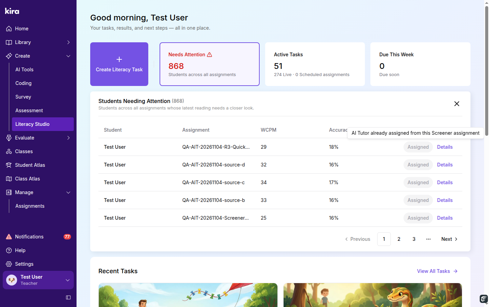

**R1-02 Quick Assign 弹窗（Scheduled 默认）**：#1 仍叫 Screener；#6 Passage 行显示正文片段而不是篇目名；#7 Scheduled 说明句；#8 去向提示大小写、标点

**R1-03 All Tasks 类型下拉**：#1 仍叫 Screener

### 创建向导

**R1-04 Step 1，未选类型**：#1 仍叫 Screener；#10 Task Type 不在第一位；#11 说明卡没和类型卡对齐；#21 Task Name placeholder；#22 “Grade Level” / “English (United States)”

**R1-05 Step 1，选 AI Tutor（G3）**：#12 阶段名不对；#13 缺 Fixed sequence 和 “New” 标签；#14 缺 Session Type；#15 时长格式

**R1-06 Step 2 粘贴框（空）**：#17 placeholder 全小写，“0 word” 单复数错

**R1-07 弃稿确认**：#20 Step 3 弃稿回到 Dashboard，不是来时的 All Tasks

**R1-08 Step 2 粘贴后**：#18 标题行被并入正文并计入字数（需用户确认）

**R1-09 Step 3 Review**：#15 时长格式；#16 估时数值（需用户确认）；#19 Practice focus（需用户确认）；#23 “STEP 1 OF 5” 全大写（需用户确认）

### Task Detail 与 Assign

**R1-10 Task Detail**：#24 面包屑；#25 编辑锁定说明应为悬停提示；#26 “View All Assignments”；#27 卡片缺时间和完成人数；#28 Live 徽标大小写（需用户确认）；#42 侧栏不高亮

**R1-11 Assign 弹窗**：#29 约 600px 单栏，产品规则是约 1000px 双栏（需用户确认）；#30 “Schedule Mode” 应为 “Scheduled Mode”

### Monitor

**R1-12 Live In Progress**：#31 没有状态筛选；#28 LIVE 全大写（需用户确认）

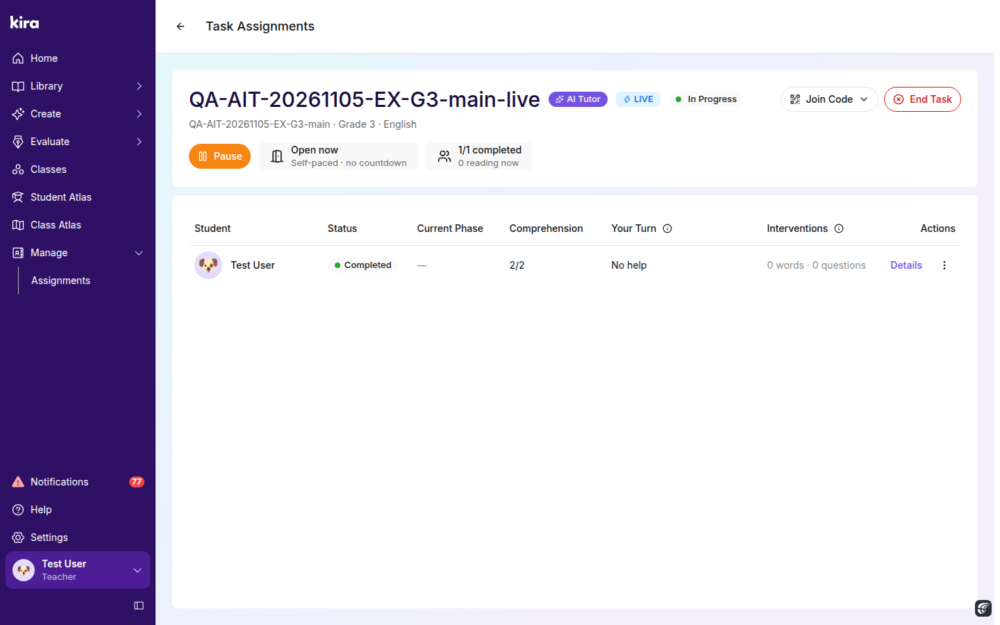

**R1-13 Remove 弹窗**：#34 警告句少半句；#35 和 End 弹窗样式不统一

**R1-14 End Task 弹窗**：#35 和 Remove 弹窗样式不统一

**R1-18 Scheduled Expired**：#31 没有状态筛选；#28 SCHEDULED 全大写（需用户确认）

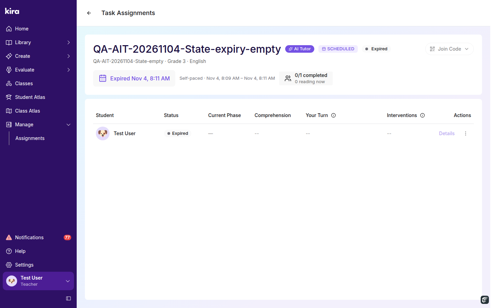

**R1-19 Ended**：#32 Join Code 置灰但悬停没有提示

### Student Detail

**R1-15 上**：#36 返回文案应为 “← Back to Assignment”；#37 翻页应为 “← Prev” / “Next →”

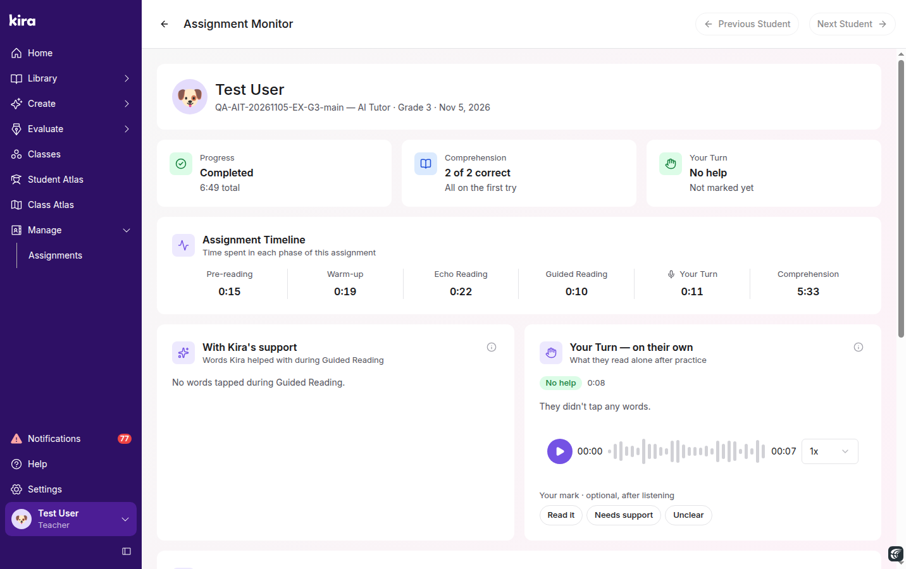

**R1-16 中**

**R1-17 下**

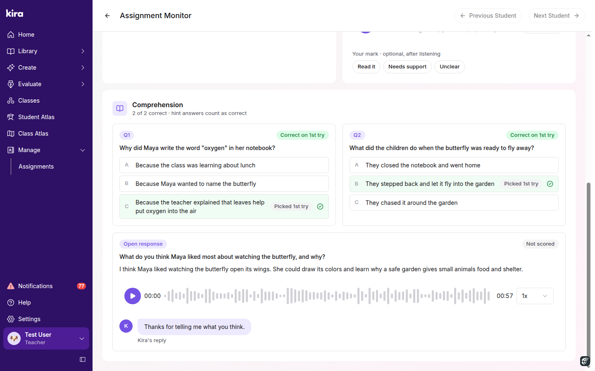

**R1-20 带提示的学生**：#38 标注按钮应为 “Read it / Still needs support / Can't tell”；#39 分组标题不该带次数

**R1-21 下半**：#40 没有 What Kira said today；#41 “Open response” 应为 “Open Response”

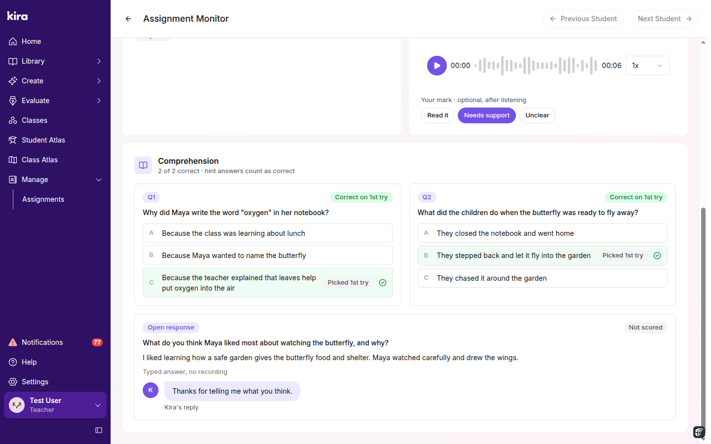

### Preview

**R1-22 Mic Check**：#43 没有学生顶栏，Exit Preview 在右上；#44 老师端侧栏一直可见

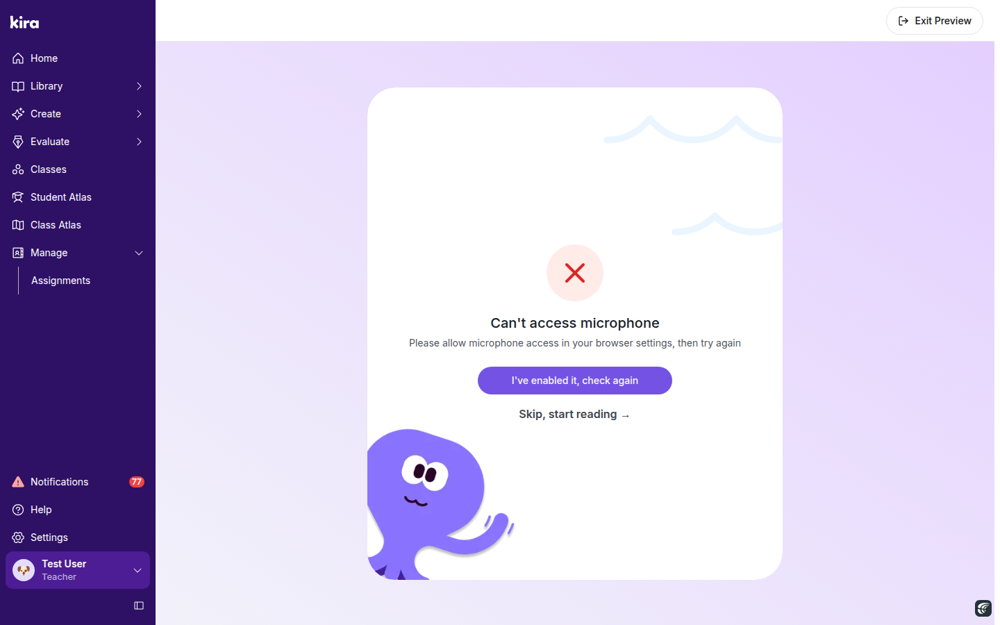

**R1-23 准备页**：#45 “Your reading is recorded for your teacher.” 和预览不存数据矛盾

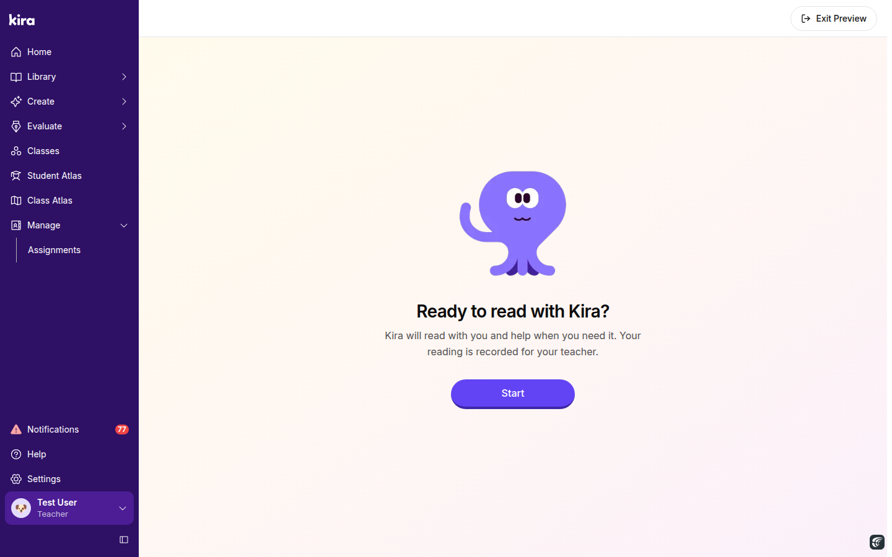

**R1-24 Intro**：#43 没有 “Step N of M · step name”

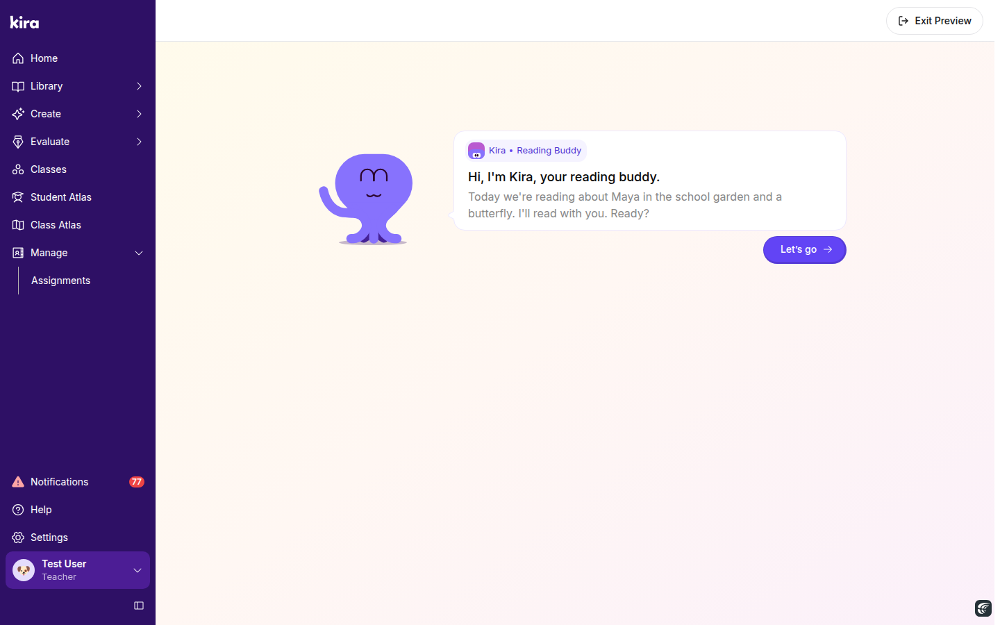

**R1-25 Warm-up**：#46 Kira 气泡和词卡释义重复

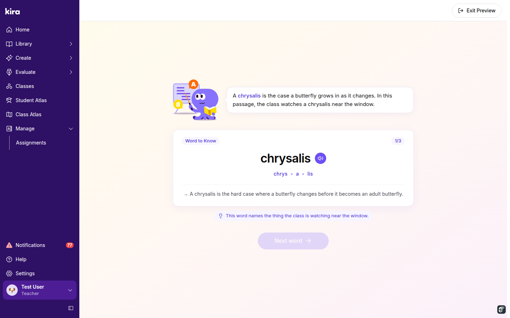

**R1-26 Echo（G3）**：#47 没有跟读录音按钮（无麦克风，需用户确认）

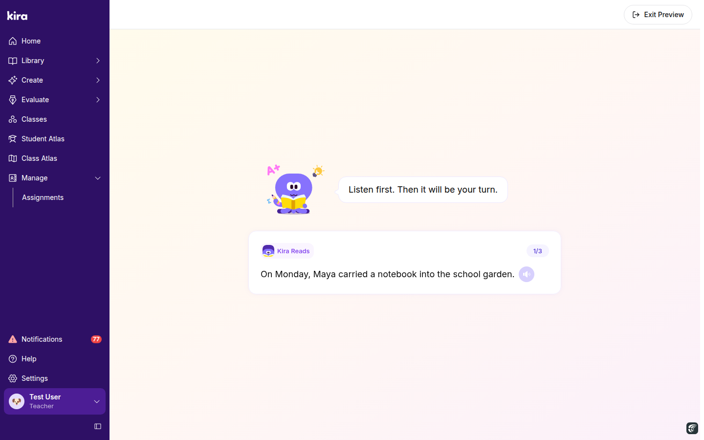

### Reading Screener 侧

**R1-27 Reading Screener Monitor，已分配悬停提示**：#3 提示文案和 PRD 不同

**R1-28 Reading Screener Student Detail 推荐面板**：#4 缺目标词、“What this passage needs”、Fixed sequence；#5 步骤名不对

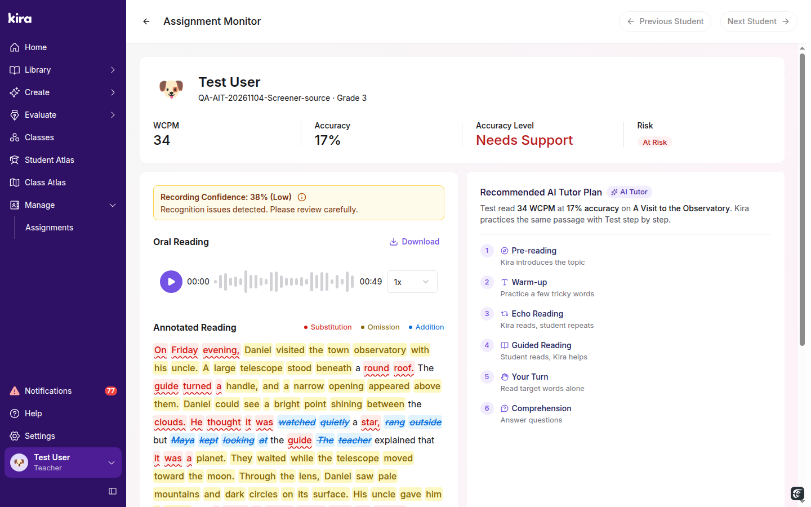
