# R1 走查报告：AI Tutor（staging 对 PRD 与设计稿）

> 日期：2026-11-13（11-16 补验证链接并复核；11-16 按本报告同步了 Figma 设计稿） · 轮次：R1 · 配套清单：`R1_修改清单.md`（51 条，下文 “#n” 指清单行号）
> 框架：`00_走查清单框架.md`。A 轨对 PRD，B 轨对规范；结论分 **已确认 / 设计判断 / 需用户确认**。

## 结论

staging 上 AI Tutor 老师端主流程都能走通，没有报错或卡死：Dashboard 入口 → 创建向导 → Task Detail → Assign → Monitor → Student Detail → Preview，以及 Reading Screener 推荐面板 → Quick Assign。问题集中在“没跟上 PRD 最近几次修订”，不是功能坏了。

一共记了 51 条：

| 类型 | 条数 | 说明 |
| --- | --- | --- |
| 已确认 | 35 | staging 和 PRD（或已确认的产品规则）明确不一致，可以直接提给前端 |
| 设计判断 | 7 | PRD 没写死，按设计经验提的改法 |
| 需用户确认 | 9 | 要用户或 PM 先拍板，清单里状态为“搁置” |

其中 46 条是 staging 的问题，5 条（#9、#48–#51）是设计稿自己落后于 PRD。这 5 条 11-16 已在 Figma 改完；#1、#10、#33 里设计稿的部分也一起改了，staging 部分还要前端改。#50 原来是需用户确认，核对 PRD 后改为已确认（见 #50）。

最要紧的 5 件事：

1. **Monitor 没有状态筛选**（#31）。PRD §5.2 要六项筛选，设计稿也画了，staging 完全没有。
2. **Preview Task 和学生端不一样**（#43–#45）。没有学生顶栏和 “Step N of M”，“Exit Preview” 在右上角而不是替换左上 Home；准备页还写着 “Your reading is recorded for your teacher.”，和“预览不存数据”矛盾。
3. **Student Detail 文案还是原型版**（#36–#41）。教师标注仍是 “Needs support / Unclear”（已定为 “Still needs support / Can't tell”），证据分组标题带次数，返回和翻页按钮文案不对，有 Kira 提示的学生看不到 What Kira said today。
4. **11-05 改名没落地**（#1、#3）。类型下拉、创建页类型卡、Quick Assign、已分配提示都还叫 “Screener”，应为 “Reading Screener”。
5. **创建向导 Step 1 没按 11-05 版改**（#10–#15）。Task Type 不在第一位；AI Tutor 步骤卡阶段名、时长格式不对，缺 Session Type（Phonics Preview）和 “Fixed sequence”。

## 范围、基准和方法

- **staging**：`staging.kira-learning.com/ai-tools/literacy-studio/`。账号默认 Admin 角色进 Literacy Studio 会 403，本轮切到 Teacher 角色（William C. Overfelt High School）走查，结束后已切回 Admin。用的是 staging 上已有的 QA 测试任务（`QA-AIT-20261104-*`、`QA-AIT-20261105-EX-G3-*` 等）。本轮没有保存新任务（向导走到 Step 3 后弃稿），Remove / End 弹窗只打开看文案，都点了 Cancel。
- **PRD**：Notion 上的 Teacher View 与 Student View，读取时为最新版（含 11-05、11-06、11-08、11-10 修订）。
- **设计稿**：Figma `pCdwCN68j1KGXz3aZZ6Wn0` 各 section 的 Latest 列：Monitor `1925:10702`、Student Detail `286:18332`、Quick Assign `1925:31830`、Create task – Latest `1947:12808`、Task details `1925:16759`。节点对照见 `需求文档/00_PRD溯源.md`。
- **判断顺序**：按 `AGENTS.md`，用户指令 > PRD > `需求文档/01_产品规则.md` > 本地文档 > 通用判断。老师端 Monitor 和 Student Detail 两边不一致时按 PRD（用户 2026-11-12）。以下几条产品规则是 PRD 的已知例外，按规则判：Assign 弹窗约 1000px 双栏、Task Detail 主按钮 “+ Assign to Students”、Preview 不加预览条并把 Home 换成 “← Exit Preview”、教师标注文案 “Read it / Still needs support / Can't tell”、Quick Assign 默认 Scheduled 且只选日期。
- **方法**：用 Chrome 无头浏览器逐屏截图并读取页面文字和悬停提示，和 PRD 原文、Figma Latest 帧逐项对照。

## 根因

1. **设计稿落后于 PRD**。10-24（学生顶栏）、10-25（AI Insights 移到 Phase 2、不显示 Primary Reading Objective、删 T8 常驻说明）、11-05（改名、Step 1 字段顺序）这几轮改动，很多没进 Figma 的 Latest 帧（#9、#48–#51）。前端照稿做就会做成旧版，比如 Step 1 字段顺序（#10）。
2. **前端文案沿用原型 PR #27776**。标注按钮、返回按钮、翻页按钮、“Open response” 都和原型一致、和 PRD 不一致（#36–#41）。2026-11-12 规则改成“两边不一致时按 PRD”，前端还没跟上。
3. **改名只改了文档**。11-05 把 Screener 改为 Reading Screener，界面字符串没有统一替换，散在至少 5 个地方（#1、#3）。
4. **共用 V1 外壳沿用生产命名**。Dashboard、All Tasks、Task Detail、Assign 弹窗和 Reading Screener 共用，“Create Literacy Task”、“← Literacy Studio”、“Grade Level”、“Schedule Mode” 都是生产上的叫法（#2、#22、#24、#30）。这类要和 Reading Screener 一起定，单改 AI Tutor 会出现两套叫法。

## A 轨：PRD 对齐

### 按锚点

| 锚点 | PRD 要求 | staging 现状 | 设计稿现状 | 是否一致 | 清单 |
| --- | --- | --- | --- | --- | --- |
| P-01 | §2.2 Needs Attention 每行 “AI Tutor” 打开 Quick Assign；已分配显示 “AI Tutor already assigned” | 入口正常；已分配提示文案多了 “from this Screener assignment” | 一致 | 部分一致 | #3 |
| P-02 | §7.4 Quick Assign：来源行、篇目名、默认 Scheduled、说明句、去向提示；推荐面板目标词与 6 步 | 默认 Scheduled、今天到 +7 天正确；篇目名、说明句、去向提示、改名不对；推荐面板缺目标词、步骤名旧 | 推荐面板正确；Quick Assign 弹窗帧落后（时刻选择、无去向提示） | 不一致 | #1、#3–#9 |
| P-03 | §3.2 六个阶段、固定顺序（Fixed sequence）、阶段名 | 阶段名用简称，没有 Fixed sequence | 一致 | 不一致 | #12、#13 |
| P-04 | §4.1 面包屑、编辑锁提示、列表标题、Preview Task；§4.2 状态 | 主按钮 “+ Assign to Students”、列表排序、状态标签正确；面包屑、编辑锁文案、列表标题不对；Preview 见下文 | 面包屑、编辑锁、列表标题正确；多一句 T8 说明 | 不一致 | #24–#27、#43–#45、#50 |
| P-05 | §7.1 Assign 弹窗；产品规则约 1000px 双栏 | 约 600px 单栏折叠；“Schedule Mode” | 约 1000px 双栏 | 不一致 | #29、#30 |
| P-06 | §5.1–§5.4 Monitor 顶栏、筛选、表格、Your Turn 标签；Phase 1 无 AI Insights | 顶栏（Join Code、End Task）、四列、占位符 “—” / “--”、Expired 状态和 “Expired {时间}” 都对；没有状态筛选；Ended 的 Join Code 没提示；(i) 提示写 “(teacher)” | 有筛选；仍有 AI Insights；(i) 提示同 staging | 不一致 | #31–#33、#49 |
| P-07 | §7.2 Remove 弹窗两句警告；§7.3 End 弹窗 | Remove 少半句警告；End 文案正确；两个弹窗样式不统一 | Remove 帧文案完整 | 部分一致 | #34、#35 |
| P-08 | §6.0 “← Back to Assignment”、“← Prev / Next →”；§6.1 头部只放身份信息 | 头部格式正确（名字 + 任务名 · 类型 · 年级 · 日期，无 T8 说明）；返回、翻页文案不对 | 正确 | 不一致 | #36、#37 |
| P-09 | §6.2 Summary 三卡、Timeline、两栏证据、标注、Comprehension / Open Response、What Kira said today | Summary 三卡、Timeline、Comprehension 卡正确；标注文案、分组标题次数、“Open response”、What Kira said today 缺失不对 | 已按 PRD 更新（`2254:29181`） | 不一致 | #38–#41 |

### 没有锚点的部分

以下几块 PRD 写得很细，但 `00_PRD溯源.md` 还没设锚点，本轮按章节号对照。**需用户确认**：要不要补 P-10（§2.3 / §3.1 / §3.3 / §3.4 创建向导）和 P-11（§4.1 Preview Task + Student View §3 学生顶栏）两个锚点，方便以后逐轮复核。

- **§2.3 All Tasks**：类型下拉只在两种类型都有时出现，这点对；选项名要改成 Reading Screener（#1）。
- **§3.1 向导导航**：左上 ← + 标题、没有右上 X、两步 / 三步的步骤条切换都正确；从 All Tasks 进来，在 Step 3 弃稿会回 Dashboard（#20）。
- **§3.2 Step 1**：见 #10–#16、#21、#22。
- **§3.3 Step 2**：粘贴框 placeholder 和字数单复数（#17）；标题行计入字数（#18）。
- **§3.4 Step 3**：多了 “Practice focus” 下拉（#19）；内嵌预览步骤标签全大写（#23）。左栏步骤编号 “2 Warm-up”、“6 Comprehension” 与 PRD 的 Student Experience chips 一致，不算问题。
- **§4.1 Preview Task + Student View §3**：见 #43–#47。

### 本轮核对过、确认没问题的

列出来是为了说明覆盖面，下一轮不用重查：

- Quick Assign 默认 Scheduled，Available from 今天、Until +7 天，只选日期；“Available from / Until” 用 Sentence case 符合写作规范。
- Task Detail 主按钮 “+ Assign to Students”；Assignment 列表按 In Progress > Not Started > Ended 排序。
- Monitor 顶栏只有 Join Code 和 End Task，没有 AI Insights（PRD 10-25 移到 Phase 2）。
- Monitor 中 Completed 学生的 Current Phase 显示 “—”，其他空值显示 “--”，与 PRD §5.3 矩阵一致。
- Scheduled 窗口到期后，状态显示 Expired、时间显示 “Expired {时间}”，与 PRD §4.2、§5 一致。
- End Task 弹窗标题、正文、按钮文案与 PRD §7.3 一致。
- Student Detail 头部只放身份信息；Summary 三卡 “答案 + 支撑事实”，卡里没有标签；只打字的开放题显示 “Typed answer, no recording”。

## B 轨：规范合规

| 检查项 | 结论 | 说明 |
| --- | --- | --- |
| token 绑定 | 本轮未查 | staging 上看不到 token。11-16 同步设计稿时新增了少量元素（见 `设计执行/日志/` 同日条目），没有做全量 token 扫描 |
| auto layout | 本轮未查 | 同上，只能在 Figma 里查 |
| 命名 | 本轮未查 | 同上 |
| UI 文案大小写 | 有问题，见下 | 按 `设计执行/规范/写作规范.md` 逐屏核对了 staging 文案 |
| 字重与图标 | 截图里没发现明显问题 | 没逐个查 DOM，不能确认箭头等是 SVG 图标还是文字字符；创建页 Reading Screener 类型卡用的是清单图标，PRD §3.2 写的是 “document-with-microphone” 图标，**需用户确认**是否同一个 |
| 组件一致性 | 有问题 | Remove 和 End 两个确认弹窗关闭图标、主按钮颜色、按钮圆角都不同（#35）；Quick Assign 用分段控件，设计稿画的是两张卡（#9） |

大小写问题：

- **全大写（ALL CAPS）**，按规范只标记、交用户定：
  - Monitor 顶部投放方式徽标 “LIVE” / “SCHEDULED”（Task Detail 卡片上却是 “Live”，同一徽标两种写法）。设计稿全部是全大写。（#28）
  - Step 3 内嵌预览 “STEP 1 OF 5 · LEARN THE WORDS”。（#23）
- **全小写**：Step 2 粘贴框 placeholder “paste passage text here...”。（#17）
- **Badge 应为 Title Case**：开放题徽标 “Open response”。（#41）
- **Modal 标题**：规范要求 Sentence case，但 staging、PRD 和设计稿都用 Title Case（“Assign to Students”、“Remove Student”、“End This Assignment?”、“Assign AI Tutor”）。PRD 原文是固定写法，按判断顺序 PRD 优先，本轮不记入清单。**需用户确认**：规范要不要给 PRD 固定写法的 Modal 标题开例外。
- **卡片标题混用**：Student Detail 的 “With Kira's support”、“Your Turn — on their own” 是 Sentence case，“Assignment Timeline” 是 Title Case。已在 `需求文档/待确认问题清单.md` #29，本轮不重复记。

## 设计稿要跟着改的地方

这几条不是 staging 的问题，但前端对稿时会被带偏。**11-16 已在 Figma 改完**，操作明细见 `设计执行/日志/` 下各文件的 2026-11-16 条目：

- 创建向导 Step 1 帧仍是 11-05 之前的版本（#48）。已改：两栏、Task Type 置顶、生产文案、左上 ← + 标题。
- Quick Assign 弹窗帧有时刻选择、没有去向提示（#9）。已改：只选日期、加去向提示、分段控件，On Track 去掉推荐卡。
- Monitor 帧仍有 AI Insights（#49）。已改：Phase 1 帧去掉按钮，原帧改名为 Phase 2。
- Task Detail 帧仍有 T8 常驻说明（#50）。已改：PRD 两处 T8 都写了 “Removed 10-25”，改为已确认后删掉。
- Preview / 学生端帧顶栏是 10-24 之前的版本（#51）。已改：顶栏只留 Home、进度条和奖杯，步骤写在页面上；学生端的 `Player Top Bar` 组件一起改了。
- 顺带改的设计稿部分：“Screener” 改名（#1）、Task Type 顺序（#10）、“(teacher mark)”（#33）。这三条 staging 还要改。
- 没改、要用户定的：Scheduled 有没有 Pause。`需求文档/01_产品规则.md` 和 PRD §4.2 写可以 Pause，PRD §5.1（10-13）写 Scheduled 没有 Pause；设计稿现在是没有。学生端帧把 K–2 画成 4 步，PRD 只有 Kindergarten 是 4 步。
- 设计稿里做对了的、staging 还没做的：Monitor 状态筛选、推荐面板目标词与 Fixed sequence、Student Detail 标注文案、Task Detail 面包屑与编辑锁提示。前端可以直接照这些帧改。

**11-16 复查**：上面几条都确认改好了。对照 PRD 原文又找到 4 处设计稿没跟上的，已一起改掉（明细见 `设计执行/日志/` 各文件的「复查补改」条目和 `决策日志.md` 同日条目）：

- 创建向导和编辑任务的 Step 3 还有 Primary Reading Objective 卡（PRD 10-25 定为 Phase 1 不显示，「根因」第 1 条提过）。已删掉；下拉帧改名为 Phase 2。staging 的 “Practice focus”（#19）还要用户定是不是这张卡。
- Kindergarten 画成 6 步，带 Your Turn（PRD 只有 5 步，没有 Your Turn）。Step 1、Step 3 和 Quick Assign 规则板已改。
- Home 任务卡没有 “AI Generating / Generation Failed” 状态（PRD §2.1，11-11）。已在卡片状态板补上；Library Cards 组件还缺 AI Tutor 的这两个变体。
- Dashboard 卡片和面板还叫 “At Risk Students”，规则板写 Monitor 学生不在名单里（PRD §2.2 是 Needs Attention / Students Needing Attention，Monitor 但 Accuracy 低于 90% 的也在）。已改。

还没改的：Step 3 学生视角预览（PRD 11-06）Figma 完全没有，staging 已经做了（#23 出在这里），要单独开任务重画；编辑任务帧顶栏还是 “← Cancel” + 居中标题，PRD 没写，要用户定。

## 测试限制

- **没有麦克风**：无头浏览器没有真实麦克风，Mic Check 走了 “Skip, start reading” 路径。Echo、Guided、Your Turn 的录音界面没测到，#47 因此是需用户确认。
- **只用了 Teacher 角色**：Admin 进不了 Literacy Studio（403），学生端只通过 Preview 看。
- **依赖已有数据**：What Kira said today 缺失（#40）可能是这条测试数据没生成，需要先查数据；G3-end 这个 Assignment 的 Details 是置灰的（没有结果），所以带提示的 Student Detail 用的是 G3-recovery 的学生。End 弹窗的 “{N} students have not completed yet…” 这句没看到，因为当时全部学生已完成，不能判断是正常隐藏还是漏了。
- **没覆盖到的情况**：K–1 路径（Oral Retelling、没有 Your Turn）、西班牙语任务、Paused 状态、Live Not Started、Behavior alert、Chat Activity 抽屉、Phonics Preview（staging 没有入口）。
- **设计稿**：走查时只读。11-16 按用户指令同步了 Figma（见上面「设计稿要跟着改的地方」），没做 token、auto layout、命名的全量扫描。

## 需用户确认汇总

清单里标“需用户确认”的 9 条（状态都是“搁置”）：

| # | 要定的事 |
| --- | --- |
| 2 | 创建按钮按 PRD 改成 “+ Create New Task”，还是保留生产的 “Create Literacy Task” |
| 16 | Step 3 时长 ~4–6 min 是否算少了，请工程核对公式 |
| 18 | 粘贴首行标题要不要拆成篇目名、要不要计入字数 |
| 19 | Step 3 的 “Practice focus” 是否就是 Phase 1 不显示的 Primary Reading Objective |
| 22 | “Grade Level” / “English (United States)” 和 PRD 的 “Grade” / “English (US)” 统一成哪个 |
| 23 | 预览步骤标签全大写是否改为 “Step 1 of 5 · Learn the words” |
| 28 | 投放方式徽标统一成 “Live” / “Scheduled”（共用组件，要和 Reading Screener 一起改） |
| 29 | Assign 弹窗本期是否按产品规则重做为约 1000px 双栏 |
| 47 | 用真实设备复测 G3 Echo Reading 的跟读录音 |

清单外还有 3 件需要用户定的事：

1. 是否给创建向导和 Preview 补 PRD 锚点（见“没有锚点的部分”）。
2. Reading Screener 类型卡图标是否就是 PRD 说的 document-with-microphone 图标。
3. 写作规范要不要给 PRD 固定写法的 Modal 标题开例外。

## 验证链接与 11-16 复核

每条问题的验证链接和操作步骤都写在下一节「逐条问题」里，和问题描述、截图放在一起；清单「位置」列里也有同样的 “验证：”。Figma 节点号可以直接点开定位到帧；PRD 链到 Notion 原页（[Teacher View](https://app.notion.com/p/34e70a1b992481f386b9c2d22bf61531)、[Student View](https://app.notion.com/p/34e70a1b99248122af86e22655dad2ca)），按 § 号找段落。

打开 staging 前先切到 **Teacher** 角色：Home 页左下角点角色名切换。Admin 打开 Literacy Studio 是 403。

几处要先操作才能看到的：

- **Quick Assign**（#1、#6–#8）：Dashboard → 点 Needs Attention 卡 → 翻到有 “AI Tutor” 按钮的页 → 点任一行 “AI Tutor”。看完点 Cancel，不要点 Assign。
- **创建向导走到 Step 3**（#15、#16、#19、#20、#23）：选 AI Tutor、填任务名、Grade 3 → Continue → Paste Text，贴一段 150–250 词的文字 → Continue，等约 30 秒生成。看完点左上 ← 再选 Discard，不会留下草稿。
- **Preview**（#43–#47）：Allow Microphone →（没有麦克风时）Skip, start reading → “Ready to read with Kira?” 页 → Start → Skip intro → Warm-up。
- **弹窗**：Remove（行尾 “⋯”）、End Task、Assign 都只看不提交，点 Cancel。

11-16 复核结果：

- staging 的 46 条里 45 条仍能复现。#47 要用有麦克风的真实设备，这次没有复核。
- 设计稿 5 条（#9、#48–#51）和清单引用的 14 个 Figma 节点都还在。#33 补上了 Monitor 提示层的节点 `2488:29877`，并补了 staging 截图 R1-29。
- #51 的修改建议更正：这帧左上已经是 “← Exit Preview”，只需要按 10-24 版更新顶栏其余部分。
- Quick Assign 的入口换了页：Needs Attention 第 1 页的学生都已分配过，只显示 “Assigned”；“AI Tutor” 按钮要翻到第 2 页。这是测试数据变了，不是问题。
- #42 细化了：只有 Literacy Studio 根路径会高亮侧栏。从侧栏进 Dashboard 再点 View All Tasks，Create 还展开但已不高亮；直接打开任何子路径（包括 `/dashboard/`）时 Create 折叠、也不高亮。修改建议相应改为所有页面（含 `/dashboard/`）都保持展开和高亮。
- 复核时量了几处尺寸，写进对应行的 “验证：”：#11 说明卡高 92px、类型卡高 126px；#29 Assign 弹窗宽 600px；#35 Remove 主按钮红色、圆角 6px，End Assignment 紫色、全圆角。
- 新发现，没有单独记入清单：同一段粘贴文字，Step 2 显示 183 words，Step 3 头部显示 184 words，相差 1 词。建议和 #18 一起请工程核对字数怎么算。

## 逐条问题

51 条按页面分组，每条把问题、验证链接和截图放在一起，编号和 `R1_修改清单.md` 的 # 一致。打开 staging 前先切到 **Teacher** 角色，弹窗只看不提交（见上一节）。

设计稿截图不放进公开仓库（沿用 `设计执行/日志/Token绑定.md` 的做法），设计稿只给 Figma 链接，点开直接定位到帧；设计稿自身的 5 条（#9、#48–#51）配的是 staging 对照截图。截图里的账号姓名和邮箱都已替换成 “Test User” / “student@example.com”，Quick Assign 弹窗里的学生行已遮住，R1-29 只截了表头和提示。

### Dashboard、All Tasks 与 Reading Screener 入口

#### #1 界面仍叫 “Screener”，没改成 “Reading Screener”

**已确认** · 待改（11-16 设计稿已同步，staging 待改）

- **问题**：11-05 改名没落地：界面上仍叫 “Screener”，PRD 已改为 “Reading Screener”
- **位置**：All Tasks 类型下拉、创建向导 Step 1 类型卡、Quick Assign 来源行、已分配提示
- **怎么验证**：[All Tasks][all] 点 “All Types” 下拉；[创建向导][create] Step 1 类型卡；Quick Assign 打开方式见 #6；已分配提示见 #3
- **设计稿**：[`1947:13072`][f-1947-13072]、[`2052:17659`][f-2052-17659]
- **依据**：P-02；[PRD Teacher View][prd-t] 开头改名说明（11-05）、§2.3、§3.2、§7.4
- **建议**：所有面向老师的显示名统一换成 “Reading Screener”（只改显示名，不动数据）；设计稿 11-16 已改

R1-03：All Tasks 类型下拉

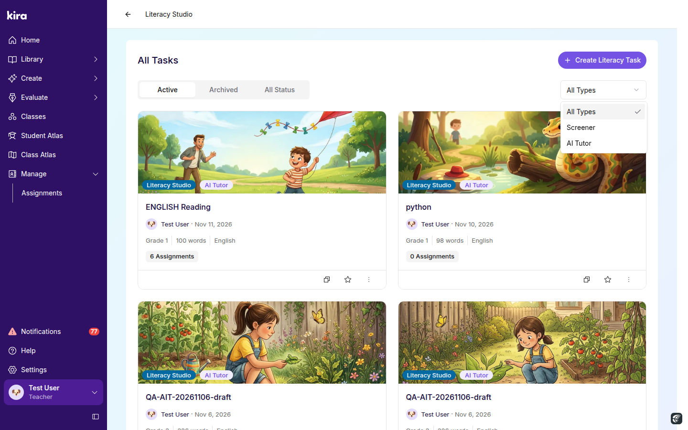

R1-04：创建向导 Step 1，未选类型

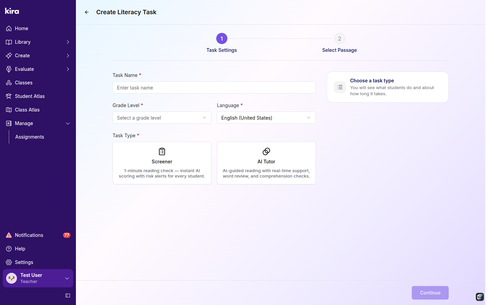

R1-02：Quick Assign 弹窗（默认 Scheduled）

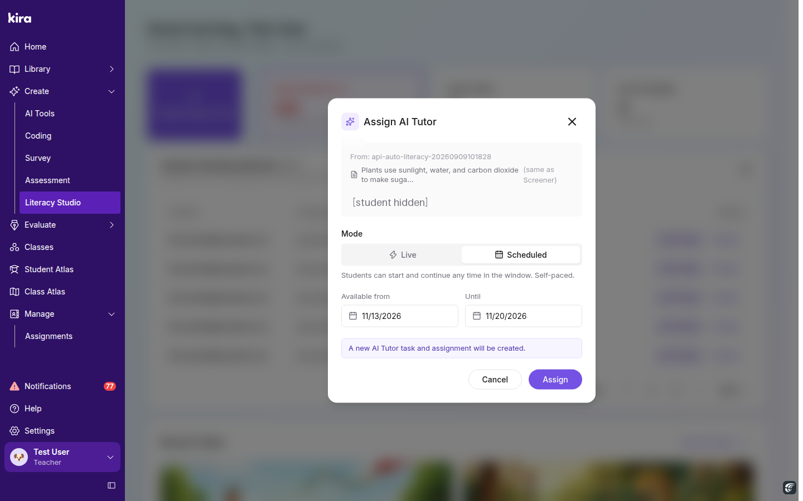

R1-01：Dashboard（打开了 Needs Attention 面板，悬停 “Assigned” 的提示）

R1-27：Reading Screener Monitor，悬停 “Assigned” 的提示

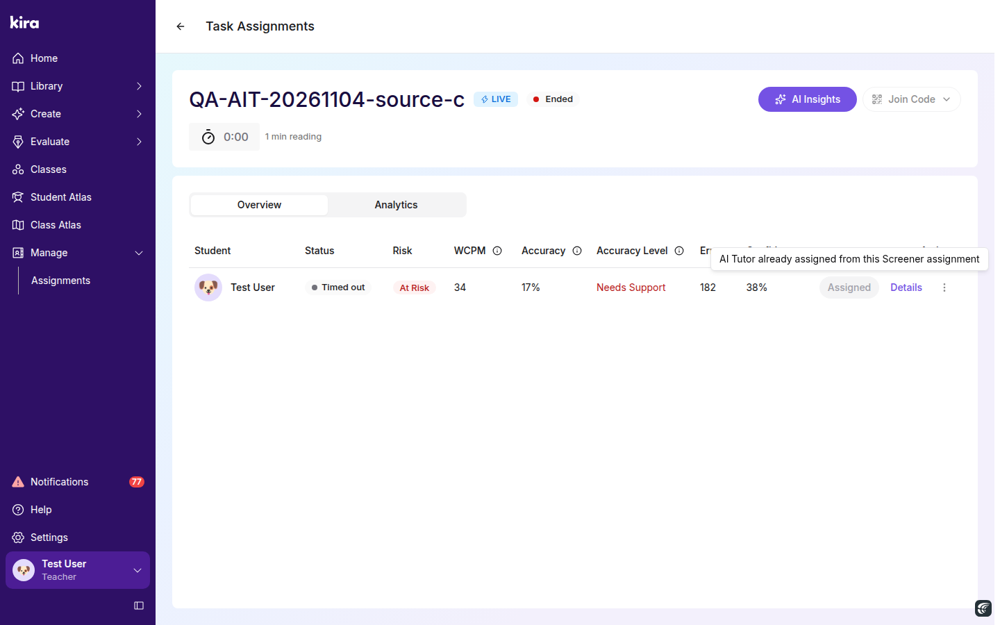

#### #2 创建按钮叫 “Create Literacy Task”，PRD 是 “+ Create New Task”

**需用户确认** · 搁置

- **问题**：PRD 写的是 “+ Create New Task”。这是和 Reading Screener 共用的 V1 外壳，生产上一直叫 Create Literacy Task
- **位置**：Dashboard 创建卡、All Tasks 右上按钮、向导页标题均为 “Create Literacy Task”
- **怎么验证**：[Dashboard][dash]、[All Tasks][all]、[创建向导][create]
- **依据**：[PRD][prd-t] §3.1 Entry and Navigation
- **建议**：确认是否按 PRD 改名；要改就和 Reading Screener 一起改

R1-01：Dashboard（打开了 Needs Attention 面板，悬停 “Assigned” 的提示）

R1-03：All Tasks 类型下拉

R1-04：创建向导 Step 1，未选类型

#### #3 已分配提示多了 “from this Screener assignment”

**已确认** · 待改

- **问题**：已分配提示写成 “AI Tutor already assigned from this Screener assignment”（推荐面板为 “AI Tutor is already assigned from this Screener assignment.”），PRD 为 “AI Tutor already assigned”
- **位置**：Dashboard Needs Attention 面板 “Assigned” 悬停提示、Reading Screener Monitor Actions 列悬停提示、Reading Screener Student Detail 推荐面板已分配说明
- **怎么验证**：[Dashboard][dash] 点 Needs Attention 卡，悬停第 1 页任一 “Assigned”；[Screener Monitor][scr-mon] 悬停 Actions 列 “Assigned”；[Screener Student Detail][scr-sd] 右侧推荐面板底部
- **设计稿**：[`2072:22227`][f-2072-22227] 已是 PRD 写法
- **依据**：P-01、P-02；[PRD][prd-t] §7.4 推荐面板状态
- **建议**：三处统一改为 “AI Tutor already assigned”

R1-01：Dashboard（打开了 Needs Attention 面板，悬停 “Assigned” 的提示）

R1-27：Reading Screener Monitor，悬停 “Assigned” 的提示

#### #4 推荐面板缺目标词、“What this passage needs” 和 Fixed sequence

**已确认** · 待改

- **问题**：推荐面板没有列出目标词，也没有 “What this passage needs” 来源标签；设计稿里有的 “Fixed sequence” 标记也没有
- **位置**：Reading Screener Student Detail 推荐面板
- **怎么验证**：[Screener Student Detail][scr-sd] 右侧 “Recommended AI Tutor Plan”
- **设计稿**：[`2066:19598`][f-2066-19598]、[`2072:22227`][f-2072-22227] 已画
- **依据**：P-02；[PRD][prd-t] §7.4（Phase 1 目标词只用 “What this passage needs” 一档）
- **建议**：按设计稿补目标词和 “What this passage needs” 标签、“Fixed sequence” 标记；文案不要暗示是按学生个人错词定制

R1-28：Reading Screener Student Detail 推荐面板

#### #5 推荐面板步骤名不对

**已确认** · 待改

- **问题**：步骤名写成 “Warm-up”、“Comprehension”；PRD 为 “Vocabulary Warm-up”，最后一步 G1 为 “Oral Retelling”、G2–5 为 “Comprehension Check”
- **位置**：推荐面板步骤列表
- **怎么验证**：[Screener Student Detail][scr-sd] 推荐面板里的 6 个步骤
- **依据**：P-02；[PRD][prd-t] §7.4（10-25 按年级列 6 步）
- **建议**：按 PRD 改步骤名，最后一步按来源年级显示

R1-28：Reading Screener Student Detail 推荐面板

#### #6 Quick Assign 的 Passage 行显示正文片段，不是篇目名

**已确认** · 待改

- **问题**：Passage 行显示的是正文开头片段（“Plants use sunlight, water…”），后面跟 “(same as Screener)”；PRD 要显示篇目名
- **位置**：Quick Assign 弹窗 Passage 行
- **怎么验证**：[Dashboard][dash] 点 Needs Attention 卡 → 翻到有 “AI Tutor” 按钮的页（11-16 在第 2 页）→ 点任一行 “AI Tutor”，看 Passage 行；看完点 Cancel，不要点 Assign
- **设计稿**：[`2052:17659`][f-2052-17659]
- **依据**：P-02；[PRD][prd-t] §7.4 Step 1
- **建议**：改为 “[Passage Name] (same as Reading Screener)”

R1-02：Quick Assign 弹窗（默认 Scheduled）

#### #7 Quick Assign 的 Scheduled 说明句不对

**已确认** · 待改

- **问题**：写成 “Students can start and continue any time in the window. Self-paced.”
- **位置**：Quick Assign 弹窗 Scheduled 说明
- **怎么验证**：按 #6 打开 Quick Assign，Mode 默认 Scheduled，看下面的说明句
- **依据**：P-02；[PRD][prd-t] §7.4 Mode
- **建议**：改为 “Students can start any time in the window and pick up where they left off.”

R1-02：Quick Assign 弹窗（默认 Scheduled）

#### #8 Quick Assign 去向提示的大小写和标点不对

**已确认** · 待改

- **问题**：写成 “A new AI Tutor task and assignment will be created.”，与 PRD 原文大小写、标点不同
- **位置**：Quick Assign 弹窗底部去向提示
- **怎么验证**：按 #6 打开 Quick Assign，看弹窗底部
- **依据**：P-02；[PRD][prd-t] §7.4 去向提示
- **建议**：按 PRD 原文：“A new AI Tutor task and Assignment will be created”；另一种情况 “A new Assignment will be created” 一并核对

R1-02：Quick Assign 弹窗（默认 Scheduled）

#### #9 设计稿 Quick Assign 帧落后

**设计判断** · 已改（11-16，Figma）

- **问题**：设计稿落后：仍有时刻选择（产品规则已定只选日期、时刻交工程默认）、没有去向提示、仍叫 Screener；模式选择画成两张卡，staging 是分段控件
- **怎么验证**：点开两帧，和 staging 的 Quick Assign（打开方式见 #6）对比
- **设计稿**：Quick Assign Latest 列 [`2052:17659`][f-2052-17659]、[`2054:18045`][f-2054-18045]
- **依据**：[产品规则][rules] “Quick Assign 默认 Scheduled…”；[PRD][prd-t] §7.4
- **建议**：设计稿去掉时刻选择、补去向提示、改名；模式控件建议跟 staging 分段控件统一（Assign 弹窗也是分段控件）

staging 对照 R1-02：Quick Assign 弹窗（默认 Scheduled）

### 创建向导

#### #10 Step 1 的 Task Type 不在第一位

**已确认** · 待改（11-16 设计稿已同步，staging 待改）

- **问题**：Task Type 排在 Task Name、Grade、Language 下面；PRD 11-05 改为左栏第一项。设计稿 11-16 已改
- **位置**：创建向导 Step 1
- **怎么验证**：[创建向导][create] Step 1 左栏，字段顺序是 Task Name → Grade Level → Language → Task Type
- **设计稿**：[`1947:13006`][f-1947-13006]、[`1947:13072`][f-1947-13072]
- **依据**：P-03；[PRD][prd-t] §3.2 Task identity fields（11-05 APACFE-4690）
- **建议**：Task Type 移到左栏最上方

R1-04：创建向导 Step 1，未选类型

R1-05：创建向导 Step 1，选 AI Tutor（G3）

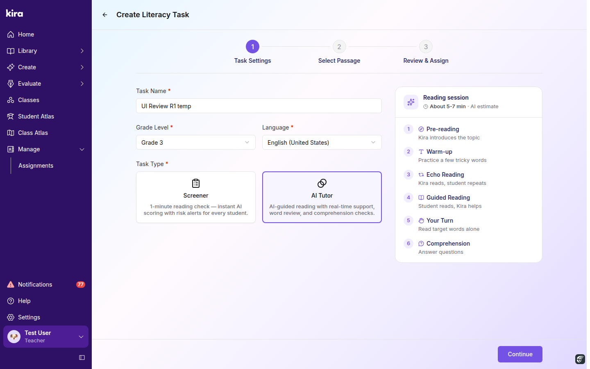

#### #11 Step 1 右栏说明卡没和类型卡对齐

**已确认** · 待改

- **问题**：说明卡顶部和 Task Name 对齐，高度也比类型卡小；PRD 要求顶部与类型卡对齐、同高
- **位置**：Step 1 右栏 “Choose a task type” 说明卡
- **怎么验证**：[创建向导][create] 先不选类型，看右栏说明卡（11-16 量得：顶部与 Task Name 齐平，高 92px；类型卡高 126px）
- **依据**：[PRD][prd-t] §3.2 Right column（11-05）
- **建议**：第 10 条改完后，说明卡顶部对齐类型卡、高度与类型卡一致

R1-04：创建向导 Step 1，未选类型

#### #12 Step 1 步骤卡阶段名不对

**已确认** · 待改

- **问题**：阶段名写成 “Warm-up”、“Comprehension”；PRD 为 “Vocabulary Warm-up”、G2–5 “Comprehension Check”、K–1 “Oral Retelling”
- **位置**：Step 1 选 AI Tutor 后的步骤卡
- **怎么验证**：[创建向导][create] 选 AI Tutor、Grade 3，看右侧步骤卡
- **依据**：P-03；[PRD][prd-t] §3.2 Session Phases
- **建议**：按 PRD 改阶段名，最后一步按年级切换

R1-05：创建向导 Step 1，选 AI Tutor（G3）

#### #13 Step 1 步骤卡缺 Fixed sequence 和 “New” 标签

**设计判断** · 待改

- **问题**：步骤卡没有 “Fixed sequence” 标记和下面那句 “Every session runs all six phases in this order…”；Your Turn 也没有 “New” 标签（设计稿有）
- **位置**：Step 1 步骤卡
- **怎么验证**：同 #12
- **设计稿**：[`1947:13072`][f-1947-13072] 已有
- **依据**：P-03；[PRD][prd-t] §3.2（参考做法，最终样式由设计定）
- **建议**：按设计稿补 “Fixed sequence” 标记、说明句和 “New” 标签

R1-05：创建向导 Step 1，选 AI Tutor（G3）

#### #14 Step 1 缺 Session Type（Reading / Phonics）

**已确认** · 待改

- **问题**：没有 Session Type 行（Reading / Phonics），看不到 Phonics 的 Preview 入口
- **位置**：Step 1 选 AI Tutor 后
- **怎么验证**：同 #12，步骤卡上方没有 Session Type 行
- **设计稿**：[`1947:13072`][f-1947-13072] 已有
- **依据**：[PRD][prd-t] §3.2 Session Type（Phonics 可见、标 Preview、不能保存）
- **建议**：补 Session Type：Reading 默认选中；Phonics 可点，显示 “Coming soon”，Step 3 不能保存

R1-05：创建向导 Step 1，选 AI Tutor（G3）

#### #15 时长显示格式不对

**已确认** · 待改

- **问题**：显示格式不对：Step 1 为 “About 5-7 min · AI estimate”；PRD 为 “~{low}-{high} min”，说明文字 “Self-paced · AI estimated”
- **位置**：Step 1 步骤卡时长、Step 3 头部时长
- **怎么验证**：Step 1 同 #12；Step 3 按 #16 的操作走到
- **依据**：[PRD][prd-t] §3.2 Est. Duration Display；§3.4
- **建议**：统一为 “~5-7 min” + “Self-paced · AI estimated”；Step 3 同步

R1-05：创建向导 Step 1，选 AI Tutor（G3）

R1-09：创建向导 Step 3 Review

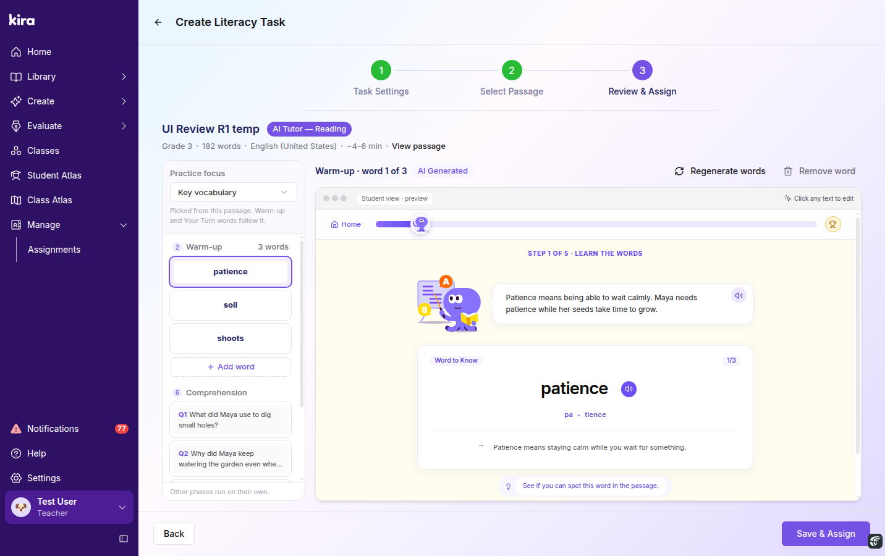

#### #16 Step 3 估时可能算少了

**需用户确认** · 搁置

- **问题**：同一个 G3 任务，Step 3 按实际篇章（约 177 词，秋季）算出 ~4–6 min；按 PRD 公式手算大约 5–7 min。Step 1 与 Step 3 数值不同本身是对的（Step 1 用年级默认字数）
- **位置**：Step 3 头部 “~4–6 min”
- **怎么验证**：[创建向导][create] 选 AI Tutor、填任务名、Grade 3 → Continue → 点 Paste Text，贴一段 150–250 词的文字 → Continue，等约 30 秒生成完看 Step 3 头部；看完点左上 ← 选 Discard
- **依据**：[PRD][prd-t] §3.2 How each step is counted / When it is computed
- **建议**：请工程核对 Step 3 的计算（尤其 Echo 和 Your Turn 两段是否算进去）

R1-09：创建向导 Step 3 Review

#### #17 Step 2 粘贴框 placeholder 全小写，“0 word” 单复数错

**已确认** · 待改

- **问题**：placeholder 是全小写 “paste passage text here...”；字数显示 “0 word”（单复数错）
- **位置**：Step 2 粘贴框
- **怎么验证**：[创建向导][create] 填完 Step 1 → Continue → 点 Paste Text
- **依据**：[PRD][prd-t] §3.3 Paste Text；[写作规范][writing] 一-5（禁全小写）
- **建议**：placeholder 改为 “Paste passage text here...”；字数改为 “0 words”（1 时用 “1 word”）

R1-06：创建向导 Step 2 粘贴框（空）

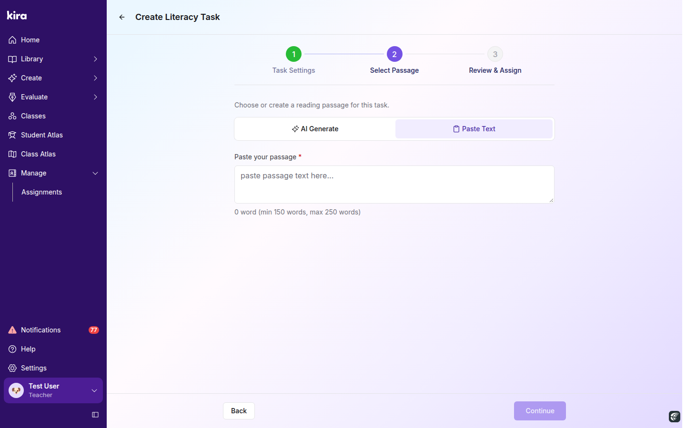

#### #18 粘贴的首行标题被计入字数

**需用户确认** · 搁置

- **问题**：粘贴内容的第一行标题被并进正文并计入字数（182 = 标题 5 词 + 正文 177 词），字数范围判断也按 182
- **位置**：Step 2 粘贴后
- **怎么验证**：同 #17，贴一段首行是标题的文字看字数（11-16 用 6 词标题 + 177 词正文，显示 183 words）
- **依据**：[PRD][prd-t] §3.3（没写标题行怎么处理）
- **建议**：请 PM 定：首行标题是否拆出来做篇目名、是否计入字数

R1-08：创建向导 Step 2 粘贴后

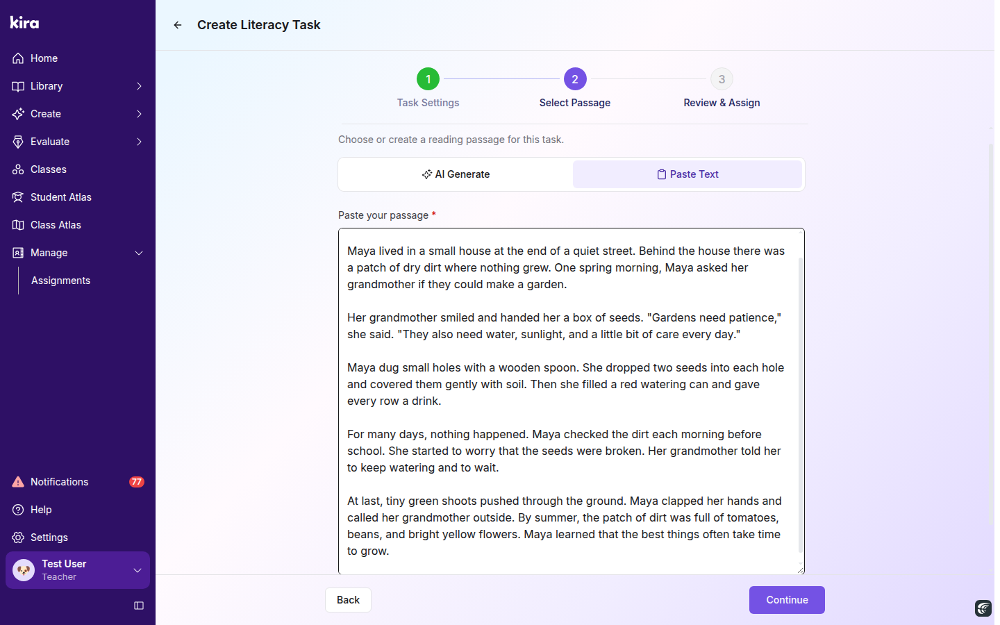

#### #19 Step 3 多了 “Practice focus” 下拉

**需用户确认** · 搁置

- **问题**：下拉下面写着 “Warm-up and Your Turn words follow it.”，作用就是 PRD 的 Primary Reading Objective；PRD 10-25 定了 Phase 1 不显示这张卡
- **位置**：Step 3 左栏 “Practice focus / Key vocabulary” 下拉
- **怎么验证**：按 #16 走到 Step 3，看左栏第一块
- **依据**：[PRD][prd-t] §3.4 [T2] Primary Reading Objective（10-25）
- **建议**：如果它就是 Objective，Phase 1 去掉；如果是别的需求，请 PM 补进 PRD

R1-09：创建向导 Step 3 Review

#### #20 从 All Tasks 进入，Step 3 弃稿后回到 Dashboard

**已确认** · 待改

- **问题**：弃稿后回到 Dashboard，不是来时的 All Tasks（Step 2 弃稿能正确回 All Tasks）
- **位置**：从 All Tasks 进入向导，到 Step 3 点 ← 并确认弃稿
- **怎么验证**：在 [All Tasks][all] 点 “Create Literacy Task”，按 #16 走到 Step 3 → 点左上 ← → Discard，落到 `/dashboard/` 而不是 `/all-tasks/`
- **依据**：[PRD][prd-t] §3.1 Wizard navigation（← 回到来时页面，11-05）
- **建议**：Step 3 的 ← 与 Step 1、2 用同一套返回逻辑

R1-07：创建向导弃稿确认

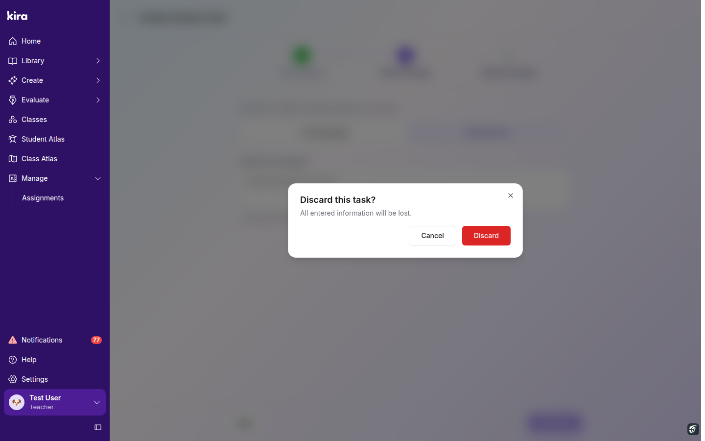

R1-09：创建向导 Step 3 Review

#### #21 Task Name placeholder 不对

**已确认** · 待改

- **问题**：placeholder 为 “Enter task name”，PRD 为 “Name your task...”
- **位置**：Step 1 Task Name 输入框
- **怎么验证**：[创建向导][create] Task Name 输入框
- **依据**：[PRD][prd-t] §3.2 Task Name
- **建议**：改为 “Name your task...”

R1-04：创建向导 Step 1，未选类型

#### #22 “Grade Level” / “English (United States)” 三方不一致

**需用户确认** · 搁置

- **问题**：字段名 “Grade Level”、语言默认值 “English (United States)”；PRD 为 “Grade”、“English (US)”。设计稿是 “Grade Level” + “English (US)”，三方不一致
- **位置**：Step 1 字段
- **怎么验证**：[创建向导][create] 看 Grade Level 字段名；选 AI Tutor 后看 Language 默认值
- **设计稿**：[`1947:13072`][f-1947-13072]
- **依据**：[PRD][prd-t] §3.2 Grade / Language
- **建议**：确认后三方统一；这是共用外壳，要和 Reading Screener 一起定

R1-04：创建向导 Step 1，未选类型

#### #23 Step 3 预览的步骤标签全大写

**需用户确认** · 搁置

- **问题**：步骤标签为全大写 “STEP 1 OF 5 · LEARN THE WORDS”
- **位置**：Step 3 右侧学生端预览
- **怎么验证**：按 #16 走到 Step 3，看右侧预览顶部
- **依据**：[写作规范][writing] 一-4（禁 ALL CAPS，交用户定夺）；[PRD Student View][prd-s] §3 顶栏规则（“Step N of M · step name”）
- **建议**：建议改为 “Step 1 of 5 · Learn the words”；学生端正式页面用同一写法

R1-09：创建向导 Step 3 Review

### Task Detail 与 Assign 弹窗

#### #24 Task Detail 返回写成 “← Literacy Studio”

**已确认** · 待改

- **问题**：写成 “← Literacy Studio”，PRD 为 “← Back to Dashboard”
- **位置**：Task Detail 左上返回
- **怎么验证**：[Task Detail][task] 左上
- **设计稿**：[`1925:16761`][f-1925-16761] 已是 PRD 写法
- **依据**：P-04；[PRD][prd-t] §4.1 Breadcrumb
- **建议**：改为 “← Back to Dashboard”

R1-10：Task Detail

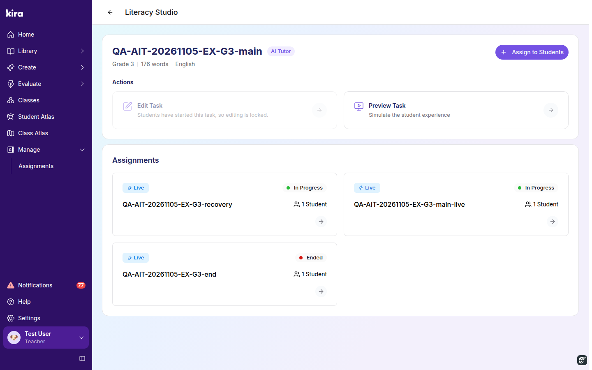

#### #25 Edit Task 锁定说明的文案和形式不对

**已确认** · 待改

- **问题**：锁定说明直接写在卡片里：“Students have started this task, so editing is locked.”；PRD 和设计稿都是悬停提示 “This task has active assignments and cannot be edited.”（文案已确认；用行内文字还是悬停提示属设计判断）
- **位置**：Task Detail Edit Task 卡片
- **怎么验证**：[Task Detail][task] Edit Task 卡片
- **设计稿**：[`1925:16761`][f-1925-16761]
- **依据**：P-04；[PRD][prd-t] §4.1 Edit Task lock
- **建议**：文案按 PRD；形式按设计稿改成悬停提示，或保留行内但换成 PRD 文案

R1-10：Task Detail

#### #26 列表标题写成 “Assignments”

**已确认** · 待改

- **问题**：写成 “Assignments”，PRD 为 “View All Assignments”
- **位置**：Task Detail 列表标题
- **怎么验证**：[Task Detail][task] Assignment 列表标题
- **依据**：P-04；[PRD][prd-t] §4.1 Assignment list
- **建议**：改为 “View All Assignments”

R1-10：Task Detail

#### #27 Assignment 卡片缺时间和完成人数

**设计判断** · 待改

- **问题**：卡片只有 “1 Student”，没有时间（Live 开始时间 / Scheduled 时间窗）和完成人数（设计稿 “8/24 Students ✓”）；列表底部也没有 “All assignments loaded”
- **位置**：Task Detail Assignment 卡片
- **怎么验证**：[Task Detail][task] Assignment 卡片和列表底部
- **设计稿**：[`1925:16761`][f-1925-16761]
- **依据**：[PRD][prd-t] §4.1（只写了底部结束语，卡片内容没写）；设计稿
- **建议**：按设计稿补时间和完成人数；底部结束语按 PRD 加上

R1-10：Task Detail

#### #28 投放方式徽标两处大小写不同

**需用户确认** · 搁置

- **问题**：同一个投放方式徽标，两个页面大小写不同；Monitor 和设计稿用了全大写
- **位置**：Task Detail 卡片 “Live”，Monitor 顶部 “LIVE” / “SCHEDULED”
- **怎么验证**：[Task Detail][task] 卡片上的 “Live”；[Monitor（Live）][mon-live] 顶部 “LIVE”；[Monitor（Scheduled · Expired）][mon-exp] 顶部 “SCHEDULED”
- **设计稿**：全部是全大写
- **依据**：[写作规范][writing] 一-1（同角色一致）、一-4（禁 ALL CAPS）、三（Badge 用 Title Case）
- **建议**：建议统一为 “Live” / “Scheduled”；这是 Reading Screener 共用组件，要一起改

R1-10：Task Detail

R1-12：Monitor（Live · In Progress）

R1-18：Monitor（Scheduled · Expired）

#### #29 Assign 弹窗是 600px 单栏，产品规则是约 1000px 双栏

**需用户确认** · 搁置

- **问题**：staging 是约 600px 单栏折叠式（接近 PRD 旧写法 520px + 三段 Accordion）；产品规则已定保留约 1000px 双栏，设计稿也是双栏
- **位置**：Task Detail “+ Assign to Students” 弹窗
- **怎么验证**：[Assign 弹窗][assign]（链接直接打开弹窗，11-16 量得宽 600px；看完点 Cancel 或按 Esc）
- **设计稿**：[`1925:16903`][f-1925-16903]
- **依据**：P-05；[产品规则][rules] “Assign 弹窗保留约 1000px 双栏（PRD 待回写）”；[PRD][prd-t] §7.1
- **建议**：请用户确认本期是让工程按双栏重做，还是接受现状并改产品规则

R1-11：Assign 弹窗

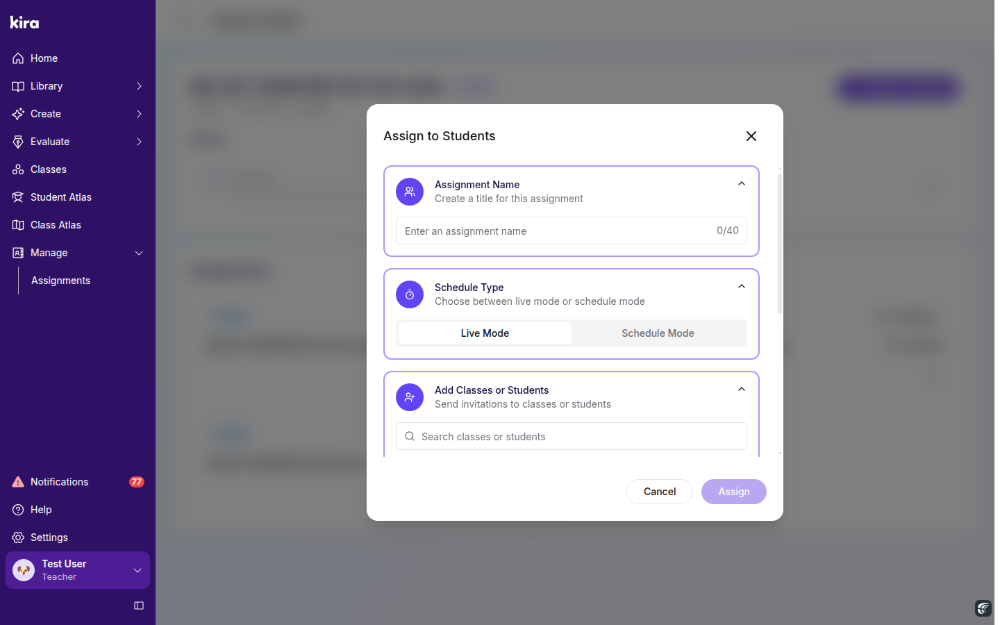

#### #30 “Schedule Mode” 应为 “Scheduled Mode”

**已确认** · 待改

- **问题**：选项写成 “Schedule Mode”，PRD 为 “Scheduled Mode”
- **位置**：Assign 弹窗 Schedule Type
- **怎么验证**：[Assign 弹窗][assign] Schedule Type 选项
- **依据**：P-05；[PRD][prd-t] §7.1 Schedule Type
- **建议**：改为 “Scheduled Mode”

R1-11：Assign 弹窗

### Monitor

#### #31 Monitor 没有状态筛选

**已确认** · 待改

- **问题**：没有状态筛选。PRD 要 All / In Progress / Completed / Ended / Expired / Not Started 六项，设计稿已画（灰底分段 Tabs）
- **位置**：AI Tutor Monitor 表格上方
- **怎么验证**：[Monitor（Live）][mon-live]、[Monitor（Scheduled · Expired）][mon-exp] 表格上方
- **设计稿**：[`2159:26726`][f-2159-26726] 等已有筛选
- **依据**：P-06；[PRD][prd-t] §5.2 Status filter
- **建议**：按设计稿补六项状态筛选（本轮最优先）

R1-12：Monitor（Live · In Progress）

R1-18：Monitor（Scheduled · Expired）

#### #32 Ended 的 Join Code 悬停没有提示

**已确认** · 待改

- **问题**：按钮置灰，但悬停没有任何提示（元素关闭了鼠标事件）
- **位置**：Ended 的 Monitor 右上 Join Code
- **怎么验证**：[Monitor（Ended）][mon-end] 悬停右上 Join Code
- **依据**：P-06；[PRD][prd-t] §4.2 Join Code（Ended：禁用 + 提示 “This assignment has ended”）
- **建议**：置灰时仍能悬停，显示 “This assignment has ended”

R1-19：Monitor（Ended），Join Code 置灰

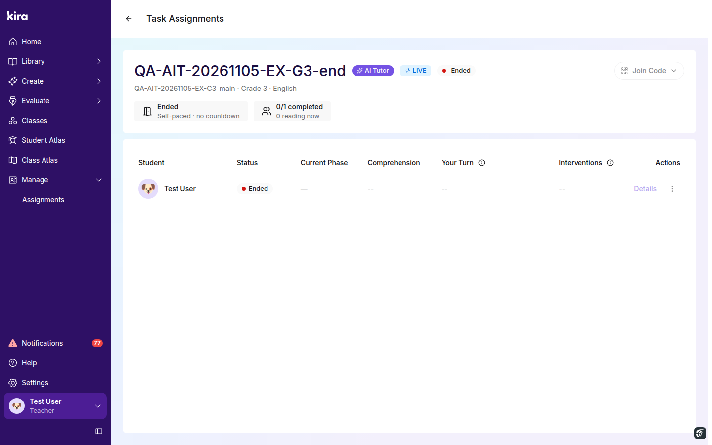

#### #33 Your Turn 提示末句写 “(teacher)”，应为 “(teacher mark)”

**已确认** · 待改（11-16 设计稿已同步，staging 待改）

- **问题**：提示末句写 “your mark then shows here as “→ … (teacher)””；PRD 为 “(teacher mark)”。设计稿 11-16 已改
- **位置**：Monitor Your Turn 列 (i) 提示
- **怎么验证**：[Monitor（Live）][mon-live] 悬停表头 Your Turn 旁的 (i)，看最后一句
- **设计稿**：Monitor 提示层 [`2488:29877`][f-2488-29877]（在 `2159:26726` 里）
- **依据**：P-06；[PRD][prd-t] §5.4.3 Teacher mark
- **建议**：改为 “(teacher mark)”；标注文案 Needed support / Still needs support 的分歧见 `待确认问题清单.md` #21

R1-29：Monitor Your Turn 表头 (i) 提示（只截了表头和提示）

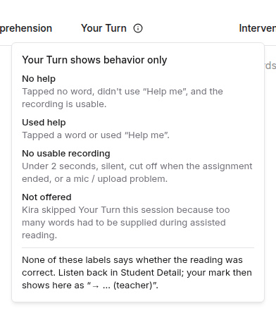

#### #34 Remove 弹窗警告少半句

**已确认** · 待改

- **问题**：只写了 “This action cannot be undone.”，少了后半句
- **位置**：Monitor 行菜单 Remove 弹窗
- **怎么验证**：[Monitor（Live）][mon-live] 学生行最右的 “⋯”（More actions）→ Remove；看完点 Cancel
- **设计稿**：[`2155:26011`][f-2155-26011]
- **依据**：P-07；[PRD][prd-t] §7.2 Warning
- **建议**：补全为 “This action cannot be undone. All progress and results for this student in this assignment will be permanently deleted.”

R1-13：Remove 弹窗

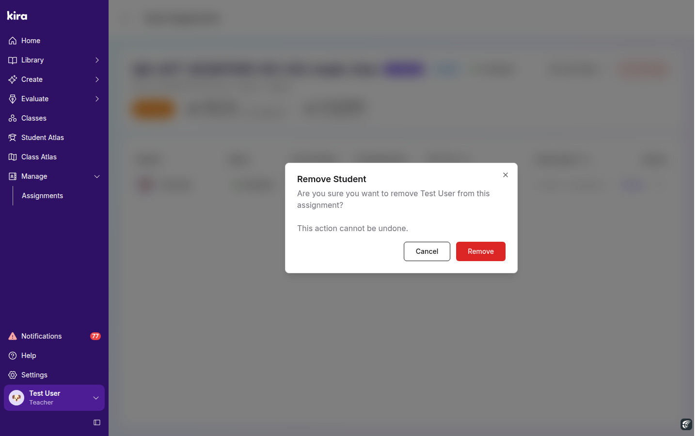

#### #35 Remove 和 End 两个弹窗样式不统一

**设计判断** · 待改

- **问题**：两个确认弹窗样式不统一：关闭图标大小和位置、主按钮红色 / 紫色、按钮圆角都不同
- **位置**：Remove 弹窗与 End Task 弹窗
- **怎么验证**：在 [Monitor（Live）][mon-live] 按 #34 打开 Remove 弹窗，再点右上 End Task 打开 End 弹窗，两个都点 Cancel（11-16：Remove 主按钮红色、圆角 6px；End Assignment 紫色、全圆角）
- **设计稿**：[`2155:26011`][f-2155-26011]、[`2160:26919`][f-2160-26919]
- **依据**：P-07（[PRD][prd-t] §7.2–§7.3）；B 轨组件一致性
- **建议**：两个弹窗用同一个确认弹窗组件；危险操作统一用红色主按钮

R1-13：Remove 弹窗

R1-14：End Task 弹窗

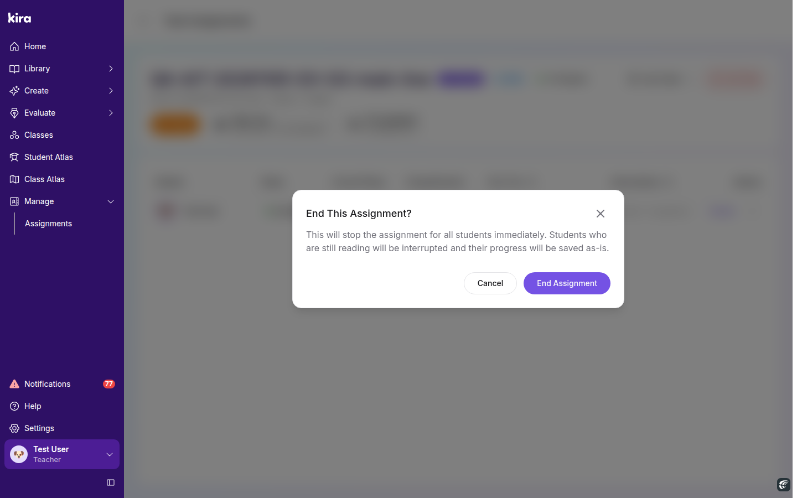

### Student Detail

#### #36 Student Detail 返回写成 “← Assignment Monitor”

**已确认** · 待改

- **问题**：写成 “← Assignment Monitor”，PRD 为 “← Back to Assignment”
- **位置**：Student Detail 左上返回
- **怎么验证**：[Student Detail][sd] 左上
- **依据**：P-08；[PRD][prd-t] §6.0
- **建议**：改为 “← Back to Assignment”

R1-15：Student Detail 顶部

R1-20：Student Detail，有 Kira 提示的学生

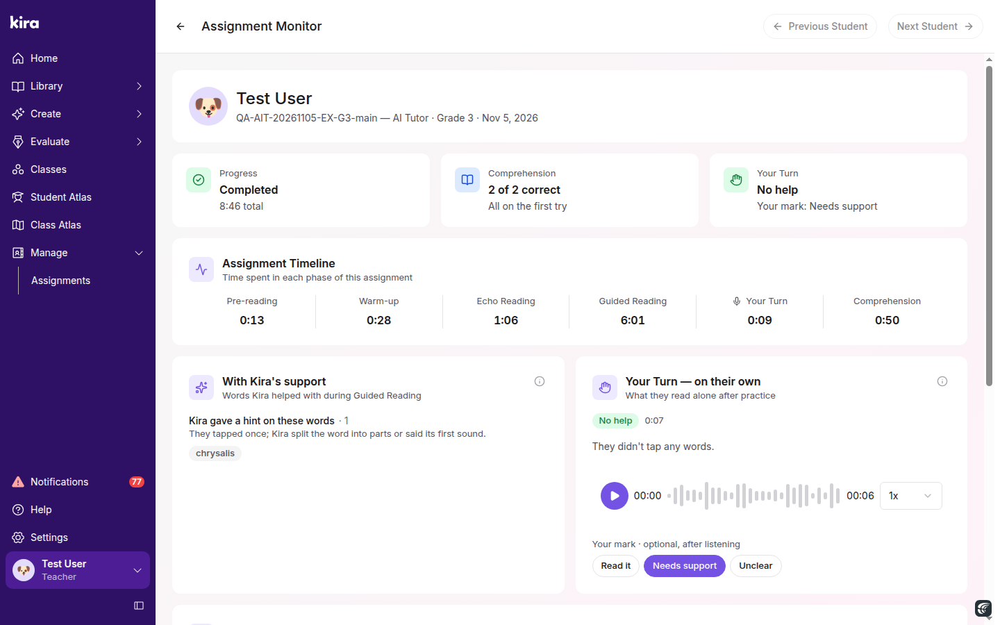

#### #37 翻页写成 “Previous Student” / “Next Student”

**已确认** · 待改

- **问题**：写成 “Previous Student” / “Next Student”，PRD 为 “← Prev” / “Next →”
- **位置**：Student Detail 右上翻页
- **怎么验证**：[Student Detail][sd] 右上
- **依据**：P-08；[PRD][prd-t] §6.0
- **建议**：改为 “← Prev” / “Next →”

R1-15：Student Detail 顶部

R1-20：Student Detail，有 Kira 提示的学生

#### #38 教师标注文案还是旧版

**已确认** · 待改

- **问题**：标注按钮为 “Read it / Needs support / Unclear”，Summary 写 “Your mark: Needs support”；已确认文案为 “Read it / Still needs support / Can't tell”
- **位置**：Student Detail 右栏标注按钮、Summary 的 Your Turn 卡
- **怎么验证**：[Student Detail][sd] 右栏 Your Turn 下的标注按钮；顶部 Summary 的 Your Turn 卡
- **设计稿**：[`2254:29181`][f-2254-29181] 已按 PRD
- **依据**：P-09；[PRD][prd-t] §6.2；[产品规则][rules] “教师标注…文案按 PRD §6.2”（2026-11-12）
- **建议**：按钮和 Summary 一起改；Monitor Your Turn 第二行也要同步

R1-20：Student Detail，有 Kira 提示的学生

#### #39 证据分组标题带了次数

**已确认** · 待改

- **问题**：分组标题写成 “Kira gave a hint on these words · 1”，带了次数
- **位置**：Student Detail 左栏 With Kira's support
- **怎么验证**：[Student Detail][sd] 左栏 “With Kira's support” 分组标题
- **依据**：P-09（[PRD][prd-t] §6.2）；[产品规则][rules] “词标签一律灰色，不写次数”
- **建议**：去掉 “· 1”

R1-20：Student Detail，有 Kira 提示的学生

#### #40 有 Kira 提示的学生看不到 What Kira said today

**已确认** · 待改

- **问题**：页面上没有 What Kira said today 卡片，但这名学生在 Guided Reading 里收到过 Kira 的提示
- **位置**：Student Detail（G3-recovery 学生，Guided Reading 有 “chrysalis” 提示）
- **怎么验证**：[Student Detail][sd] 左栏有 “chrysalis” 提示，整页没有 What Kira said today 卡片
- **设计稿**：[`2253:29137`][f-2253-29137]
- **依据**：P-09；[PRD][prd-t] §6.2；[产品规则][rules] “What Kira said today 最多 5 条…Phase 1 只收 Guided Reading 点词后的提示…”
- **建议**：先查是后端没产出数据还是前端没渲染，再修

R1-20：Student Detail，有 Kira 提示的学生

R1-21：Student Detail 下半（Comprehension）

#### #41 “Open response” 应为 “Open Response”

**已确认** · 待改

- **问题**：徽标写成 “Open response”，PRD 为 “Open Response”
- **位置**：Student Detail Comprehension 区开放题
- **怎么验证**：[Student Detail][sd] 往下滚到 Comprehension 区
- **依据**：P-09；[PRD][prd-t] §6.2 Open Response card；[写作规范][writing] 三（Badge 用 Title Case）
- **建议**：改为 “Open Response”

R1-21：Student Detail 下半（Comprehension）

### 侧栏导航

#### #42 深层页面侧栏不再高亮 Literacy Studio

**设计判断** · 待改

- **问题**：进到深层页面后，侧栏 Create 折叠、Literacy Studio 不再高亮，老师看不出自己在哪个模块（Dashboard 页是高亮的，R1-01）。11-16 复核：只有根路径 `/ai-tools/literacy-studio/` 高亮；从侧栏进 Dashboard 再点 View All Tasks，Create 还展开但已不高亮；直接打开任何子路径（包括 `/dashboard/`）时 Create 折叠、也不高亮
- **位置**：All Tasks、Task Detail、Monitor、Student Detail、Preview 的左侧导航
- **怎么验证**：先开 [Dashboard][dash]（Create 展开、Literacy Studio 高亮），再开 [All Tasks][all] 或 [Task Detail][task] 对比
- **依据**：导航一致性
- **建议**：Literacy Studio 下所有页面（含 `/dashboard/`）都保持 Create 展开、Literacy Studio 高亮

R1-01：Dashboard（打开了 Needs Attention 面板，悬停 “Assigned” 的提示）

R1-10：Task Detail

### Preview

#### #43 Preview 没有学生顶栏，Exit Preview 位置不对

**已确认** · 待改

- **问题**：预览页没有学生顶栏（Home、进度条、奖杯），页面上也没有 “Step N of M · step name”；“Exit Preview” 在右上角，不是替换左上的 Home。Step 3 内嵌预览是有顶栏的（R1-09），两处不一致
- **位置**：Task Detail → Preview Task
- **怎么验证**：[Preview][preview] 点 Allow Microphone →（没有麦克风时）Skip, start reading → Start → Skip intro，每一页都看顶部
- **设计稿**：[`2118:33782`][f-2118-33782]
- **依据**：[PRD][prd-t] §4.1 Preview Task；[PRD Student View][prd-s] §3 Player top bar（10-24）；[产品规则][rules] “Preview 不加预览条…Home 换成 ← Exit Preview”
- **建议**：预览页用学生端同一顶栏，左上 Home 换成 “← Exit Preview”；页面上补步骤编号

R1-24：Preview Intro

R1-25：Preview Warm-up

R1-26：Preview Echo Reading（G3）

#### #44 Preview 嵌在老师端外壳里

**设计判断** · 待改

- **问题**：预览嵌在老师端外壳里，左侧导航一直可见，和学生真实看到的全屏页面不一样
- **位置**：Preview 页
- **怎么验证**：[Preview][preview] 左侧老师端导航一直在
- **依据**：[PRD][prd-t] §4.1（预览 = 学生端体验）
- **建议**：预览改为全屏学生端页面，只留 “← Exit Preview” 出口

R1-22：Preview Mic Check

#### #45 Preview 准备页写着 “Your reading is recorded for your teacher.”

**已确认** · 待改

- **问题**：预览里仍写 “Your reading is recorded for your teacher.”，但 PRD 规定预览不保存任何学生数据
- **位置**：Preview 的 “Ready to read with Kira?” 页
- **怎么验证**：[Preview][preview] 点 Allow Microphone →（没有麦克风时）Skip, start reading，看 “Ready to read with Kira?” 页
- **依据**：[PRD][prd-t] §4.1 Preview Task（No student data is saved）
- **建议**：预览模式隐藏这句，或换成不涉及记录的说法（产品规则不加预览条，所以不要加横幅）

R1-23：Preview 准备页 “Ready to read with Kira?”

#### #46 Warm-up 的 Kira 气泡和词卡释义重复

**设计判断** · 待改

- **问题**：Kira 气泡里的释义和下面词卡的释义几乎一样，同一屏讲了两遍
- **位置**：Preview Warm-up
- **怎么验证**：[Preview][preview] 按 #43 走到 Warm-up 第 1 个词 “chrysalis”
- **依据**：[PRD][prd-t] §3.4 [T9]（Kira 讲解 = 意思 + 文中用法）
- **建议**：气泡偏“这个词在文中怎么用”，词卡保留简短释义，两段不要重复

R1-25：Preview Warm-up

#### #47 Echo Reading 没看到跟读录音按钮

**需用户确认** · 搁置

- **问题**：页面上没有跟读录音按钮。本轮是无麦克风的无头浏览器，走了 “Skip, start reading” 路径，不能确定有麦克风时是否正常
- **位置**：Preview Echo Reading（G3）
- **怎么验证**：用有麦克风的真实设备打开 [Preview][preview]，允许麦克风，走到 Echo Reading
- **依据**：[PRD Student View][prd-s] §3.5 Echo（G3–5 每句跟读录音）
- **建议**：请用真实设备复测一次 G3 Echo

R1-26：Preview Echo Reading（G3）

### 设计稿自身

#### #48 设计稿创建向导帧落后于 11-05

**已确认** · 已改（11-16，Figma）

- **问题**：设计稿落后于 11-05：Task Type 不在第一位、仍叫 Screener、类型卡描述和生产文案不同（PRD 要求沿用生产文案）、顶栏是 “← Cancel” + 居中标题（PRD 为左上 ← + 标题）
- **怎么验证**：点开两帧，和 [创建向导][create] Step 1 对比
- **设计稿**：创建向导 Latest 列 [`1947:13006`][f-1947-13006]、[`1947:13072`][f-1947-13072]
- **依据**：[PRD][prd-t] §3.1、§3.2（11-05 APACFE-4690）
- **建议**：设计稿按 11-05 版更新

staging 对照 R1-04：创建向导 Step 1，未选类型

#### #49 设计稿 Monitor 帧仍有 AI Insights

**已确认** · 已改（11-16，Figma）

- **问题**：设计稿仍有 AI Insights 按钮和面板；PRD 10-25 已把 AI Insights 整体移到 Phase 2（staging 已去掉，是对的）
- **怎么验证**：点开看右上的 AI Insights 按钮，和 [Monitor（Live）][mon-live] 对比
- **设计稿**：Monitor Latest 列 [`2159:26726`][f-2159-26726] 等
- **依据**：[PRD][prd-t] §5.1、§5.6（10-25）
- **建议**：设计稿 Phase 1 帧去掉 AI Insights，另存 Phase 2 帧

staging 对照 R1-12：Monitor（Live · In Progress）

#### #50 设计稿 Task Detail 帧仍有 T8 常驻说明

**已确认** · 已改（11-16，Figma）

- **问题**：标题下仍有常驻说明 “This is assisted practice; results are not used for risk classification.”；PRD §4.1 没有这句，§6.1 已于 10-25 删掉同一句（staging 没有，是对的）
- **怎么验证**：点开看标题下的说明句，和 [Task Detail][task] 对比
- **设计稿**：Task Detail [`1925:16761`][f-1925-16761]
- **依据**：[PRD][prd-t] §4.1、§6.1 [T8]（10-25）
- **建议**：建议设计稿也删掉；请确认
- **11-16 更正**：PRD §6.1 [T8] 和 [T8 · Global naming] 两处都把这句划掉了，写明 “Removed 10-25”；`需求文档/01_产品规则.md` 第 33 行也已写明删除。不需要再确认，改为已确认，设计稿已删

staging 对照 R1-10：Task Detail

#### #51 设计稿 Preview / 学生端顶栏是旧版

**已确认** · 已改（11-16，Figma）

- **问题**：顶栏还是旧版（“AI Tutor: Warm-up”、“Next level”）；10-24 已改为只有 Home + 进度条 + 奖杯，步骤编号写在页面上
- **怎么验证**：点开看顶栏
- **设计稿**：Preview / 学生端 Warm-up 帧 [`2118:33782`][f-2118-33782]
- **依据**：[PRD Student View][prd-s] §3 Player top bar（10-24）
- **建议**：设计稿顶栏按 10-24 版更新（只留 Home + 进度条 + 奖杯，步骤编号写在页面上）；这帧左上已经是 “← Exit Preview”，保留

staging 对照 R1-25：Preview Warm-up

### 其余截图

Student Detail 往下滚的中段和底部。能看到 #38 的标注按钮和 #41 的 “Open response”，这两条上面已经用 R1-20、R1-21 说明。

R1-16：Student Detail 中段

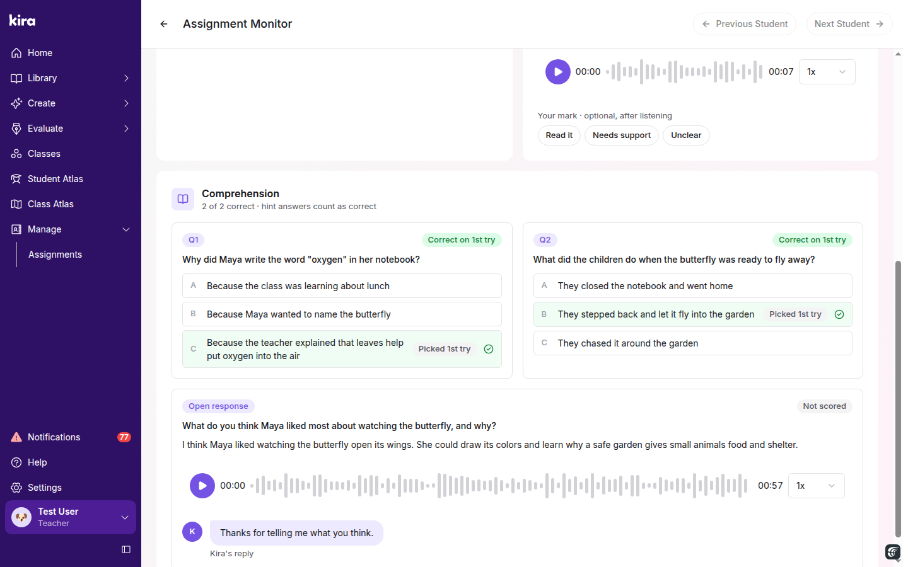

R1-17：Student Detail 底部

[dash]: https://staging.kira-learning.com/ai-tools/literacy-studio/
[all]: https://staging.kira-learning.com/ai-tools/literacy-studio/all-tasks/
[create]: https://staging.kira-learning.com/ai-tools/literacy-studio/create/?from=all-tasks
[task]: https://staging.kira-learning.com/ai-tools/literacy-studio/task/01a1aacb-5c23-7426-bf3e-45055e0a6346/
[assign]: https://staging.kira-learning.com/ai-tools/literacy-studio/task/01a1aacb-5c23-7426-bf3e-45055e0a6346/?assign=true
[mon-live]: https://staging.kira-learning.com/ai-tools/literacy-studio/task/01a1aacb-5c23-7426-bf3e-45055e0a6346/session/01a1aae5-14de-757d-bb9f-25878f5c3a1d/
[mon-end]: https://staging.kira-learning.com/ai-tools/literacy-studio/task/01a1aacb-5c23-7426-bf3e-45055e0a6346/session/01a1ab18-0f0b-71fc-89bc-e3151932b234/
[mon-exp]: https://staging.kira-learning.com/ai-tools/literacy-studio/task/01a1a58b-3385-770f-bc79-35937691ac3d/session/01a1a59b-ec21-76b5-a02f-2a336a1b55f4/
[sd]: https://staging.kira-learning.com/ai-tools/literacy-studio/task/01a1aacb-5c23-7426-bf3e-45055e0a6346/session/01a1aaf9-a829-705d-8bee-2edaf7cde712/student/0196ec29e03077fc9d420a91f5543373/
[preview]: https://staging.kira-learning.com/ai-tools/literacy-studio/task/01a1aacb-5c23-7426-bf3e-45055e0a6346/preview/
[scr-mon]: https://staging.kira-learning.com/ai-tools/literacy-studio/task/01a1a4bf-a0c7-72d2-a132-4ef9446fbc7f/session/01a1a4ee-b010-762d-966e-9070b8c8fe6a/
[scr-sd]: https://staging.kira-learning.com/ai-tools/literacy-studio/task/01a1a4bf-a0c7-72d2-a132-4ef9446fbc7f/session/01a1a4ee-b010-762d-966e-9070b8c8fe6a/student/0196ec29e03077fc9d420a91f5543373/
[prd-t]: https://app.notion.com/p/34e70a1b992481f386b9c2d22bf61531
[prd-s]: https://app.notion.com/p/34e70a1b99248122af86e22655dad2ca
[rules]: ../需求文档/01_产品规则.md
[writing]: ../设计执行/规范/写作规范.md
[f-1925-16761]: https://www.figma.com/design/pCdwCN68j1KGXz3aZZ6Wn0/Literacy-Studio-AI-Tutor?node-id=1925-16761
[f-1925-16903]: https://www.figma.com/design/pCdwCN68j1KGXz3aZZ6Wn0/Literacy-Studio-AI-Tutor?node-id=1925-16903
[f-1947-13006]: https://www.figma.com/design/pCdwCN68j1KGXz3aZZ6Wn0/Literacy-Studio-AI-Tutor?node-id=1947-13006
[f-1947-13072]: https://www.figma.com/design/pCdwCN68j1KGXz3aZZ6Wn0/Literacy-Studio-AI-Tutor?node-id=1947-13072
[f-2052-17659]: https://www.figma.com/design/pCdwCN68j1KGXz3aZZ6Wn0/Literacy-Studio-AI-Tutor?node-id=2052-17659
[f-2054-18045]: https://www.figma.com/design/pCdwCN68j1KGXz3aZZ6Wn0/Literacy-Studio-AI-Tutor?node-id=2054-18045
[f-2066-19598]: https://www.figma.com/design/pCdwCN68j1KGXz3aZZ6Wn0/Literacy-Studio-AI-Tutor?node-id=2066-19598
[f-2072-22227]: https://www.figma.com/design/pCdwCN68j1KGXz3aZZ6Wn0/Literacy-Studio-AI-Tutor?node-id=2072-22227
[f-2118-33782]: https://www.figma.com/design/pCdwCN68j1KGXz3aZZ6Wn0/Literacy-Studio-AI-Tutor?node-id=2118-33782
[f-2155-26011]: https://www.figma.com/design/pCdwCN68j1KGXz3aZZ6Wn0/Literacy-Studio-AI-Tutor?node-id=2155-26011
[f-2159-26726]: https://www.figma.com/design/pCdwCN68j1KGXz3aZZ6Wn0/Literacy-Studio-AI-Tutor?node-id=2159-26726
[f-2160-26919]: https://www.figma.com/design/pCdwCN68j1KGXz3aZZ6Wn0/Literacy-Studio-AI-Tutor?node-id=2160-26919
[f-2253-29137]: https://www.figma.com/design/pCdwCN68j1KGXz3aZZ6Wn0/Literacy-Studio-AI-Tutor?node-id=2253-29137
[f-2254-29181]: https://www.figma.com/design/pCdwCN68j1KGXz3aZZ6Wn0/Literacy-Studio-AI-Tutor?node-id=2254-29181
[f-2488-29877]: https://www.figma.com/design/pCdwCN68j1KGXz3aZZ6Wn0/Literacy-Studio-AI-Tutor?node-id=2488-29877
