# R1 评论复核：APACUIX-543 评论对 PRD、PR #12 和 staging

> 日期：2026-11-16 · 对象：[APACUIX-543 评论](https://linear.app/kira-learning/issue/APACUIX-543/design-qa#comment-c5d2e781) 里的 37 条（存档见 `Linear/评论草稿/APACUIX-543.md`）
> 对照：[PRD Teacher View](https://app.notion.com/p/34e70a1b992481f386b9c2d22bf61531) 和 [Student View](https://app.notion.com/p/34e70a1b99248122af86e22655dad2ca)（11-16 读 Notion 原文）；[PR #12](https://github.com/chao653/Literacy-Studio/pull/12) 正文「逐条问题」；staging（Teacher 角色，按评论里的验证链接逐条打开）。
> 做法：弹窗只看不提交，都点 Cancel；向导走完点 ← 再 Discard，没有保存任务；结束后切回 Admin。截图里的账号姓名已换成 “Test User”，Quick Assign 学生行已遮住。
> 评论正文这次没改，下面列出的更正等用户确认后再改评论。
> 11-17：按用户指示在 APACUIX-543 下建了 6 个 sub issue（[APACUIX-544](https://linear.app/kira-learning/issue/APACUIX-544)–[549](https://linear.app/kira-learning/issue/APACUIX-549)），下面的更正（分级拆开、补细节、Live 说明句并进第 7 条）都已写进 sub issue，评论区本身还是原样。存档见 `Linear/评论草稿/APACUIX-543-子任务.md`。

## 结论

- 37 条在 staging 上都还能复现，没有已经修好的。
- staging 和评论对不上的有 5 处：第 1 条少了 2 个位置、还有 1 个位置写错；第 15 条没写 Step 3 现状；第 35 条、第 46 条和清单外那条可以写得更具体。
- 新发现 1 条评论和 PR 都没有的问题：Quick Assign 选 Live 时的说明句和 PRD 不一样。
- PRD 和评论对不上的有 5 处：第 32 条章节号写错；第 5 条漏了 Kindergarten；第 3、4、13 条的分级要拆开，一部分有 PRD 原文，一部分只是设计判断。
- PRD 自己前后不一致的有 3 处，分别影响第 33/38 条、第 43/45 条和第 5/12 条的依据。
- PR #12 和评论的 37 条状态、标题、截图都一致。PR 正文第 1、10、33 条里有 3 处 “设计稿还要同步” 的旧说法，已改。PR 结论里的 “至少 5 处还叫 Screener” 偏少，实际可见的有 8 处。

## 一、staging 和评论不一致

### 1. 第 1 条：位置少了 2 处，有 1 处写错

**已确认**

- **怎么看**：[All Tasks](https://staging.kira-learning.com/ai-tools/literacy-studio/all-tasks/) 往下滚到 “QA-AIT-20261104-Screener-source” 任务卡，看封面图上的类型标签；[创建向导](https://staging.kira-learning.com/ai-tools/literacy-studio/create/?from=all-tasks) Step 1 点 Screener 类型卡，看右侧步骤卡标题；Quick Assign 的打开方式同评论第 6 条。
- **差异**：
  - 评论没列 All Tasks 任务卡的类型标签，staging 写的是 “Screener”。
  - 评论没列 Step 1 选中后右侧步骤卡的标题，staging 写的是 “Screener”。PRD §3.2 写明这张卡的标题是 “Reading Screener”。
  - 评论写的 “Quick Assign 来源行” 不准。From 行显示的是任务名，这符合 PRD。真正还叫 Screener 的是 Passage 行的 “(same as Screener)”（第 6 条已提），还有弹窗的读屏说明 “Assign AI Tutor practice on the same passage as the Screener.”。这句读屏说明在屏幕上看不到（只有 1×1 像素），读屏软件会念出来，所以 11-13 的 R1-02 截图里也没有。
- **建议评论改成**：位置为 “All Tasks 类型下拉和任务卡类型标签、创建向导 Step 1 类型卡和步骤卡标题、Quick Assign Passage 行和读屏说明、已分配提示”。

R1-32：All Tasks 任务卡类型标签（11-16）

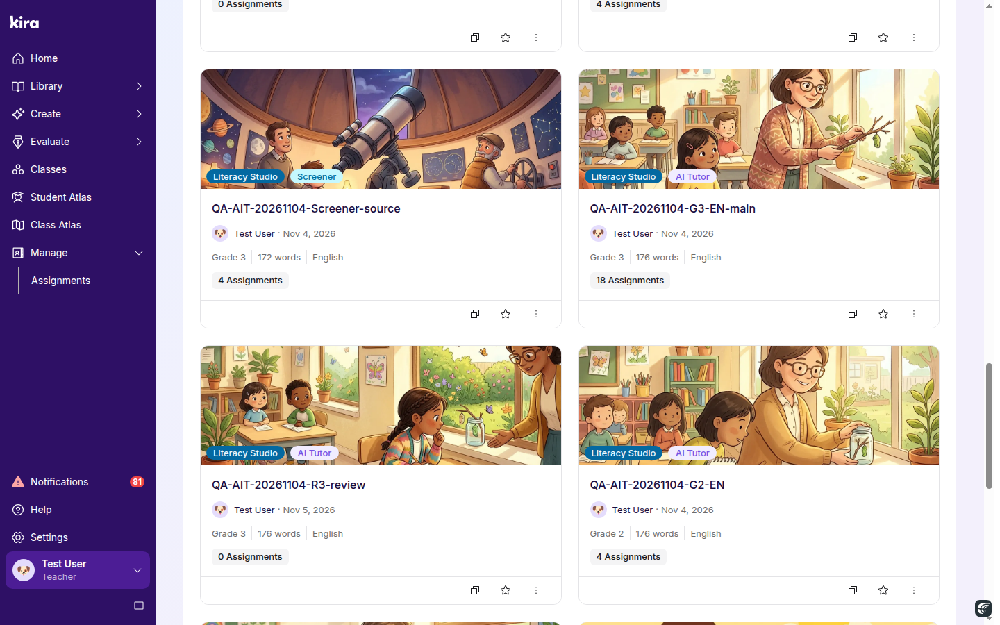

R1-31：创建向导 Step 1 选 Screener 后的步骤卡（11-16）

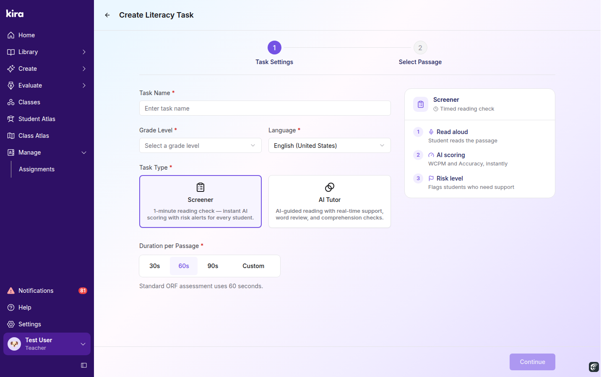

### 2. 第 15 条：没写 Step 3 现状

**已确认**（缺说明文字）；横线写法属**设计判断**

- **怎么看**：按评论开头「走到 Step 3」的步骤走到 Step 3，看任务名下面那一行。
- **差异**：评论只写了 Step 1 的 “About 5-7 min · AI estimate”。Step 3 头部已经是 “~4–6 min” 的格式，但用的是长横线 “–”（Step 1 和 PRD 都是短横线 “-”），后面也没有 “Self-paced · AI estimated”。PRD §3.4 写的是 `~{low}-{high} min`，说明文字 “Self-paced · AI estimated”。
- **建议评论补**：“Step 3 为 ‘~4–6 min’，缺 ‘Self-paced · AI estimated’；横线和 Step 1 统一用短横线”。

R1-09：创建向导 Step 3 Review

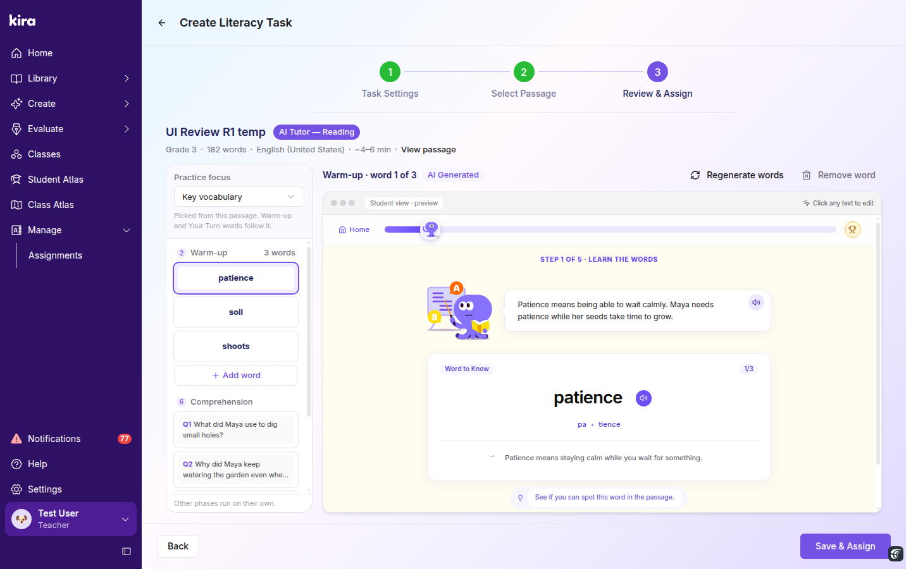

### 3. 第 35 条：可以补具体差异

**设计判断**（分级不变）

- **怎么看**：同评论第 35 条。
- **差异**：评论只说了关闭图标、按钮颜色和圆角不同。11-16 量得更具体：Remove 弹窗宽 480px，关闭是 16px 的图标，主按钮红色、圆角 6px；End 弹窗宽 600px，关闭是 36px 的按钮，主按钮紫色、全圆角。另外，End 弹窗右上的关闭按钮，读屏名称是 “Cancel”，和底部 Cancel 按钮重名。
- **建议评论补**：两个弹窗宽度不同；End 弹窗关闭按钮的读屏名称改成 “Close”。

R1-13：Remove 弹窗

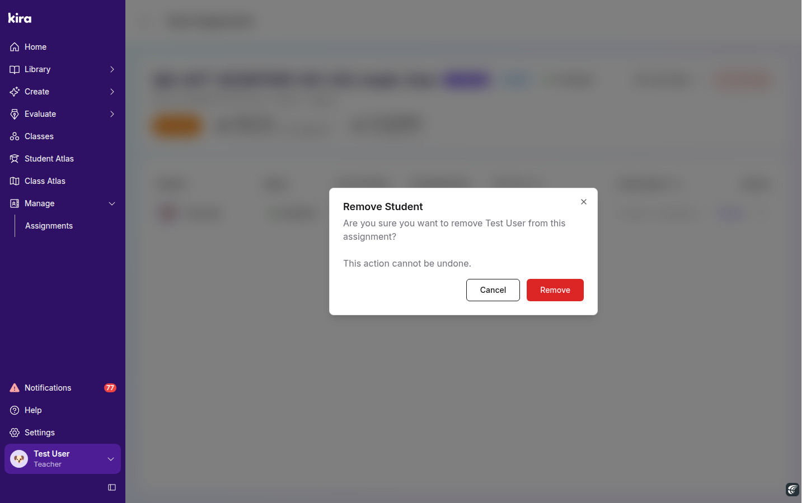

R1-14：End Task 弹窗

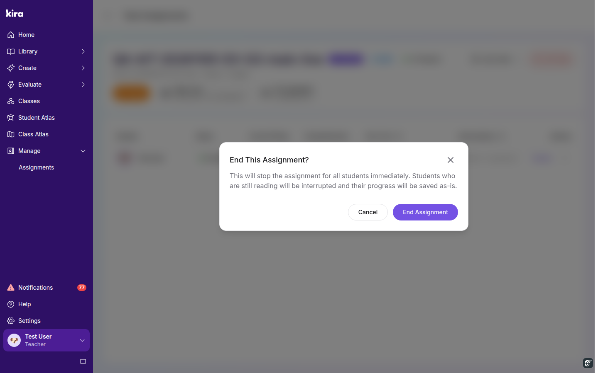

### 4. 第 46 条：文中用法也讲了两遍

**设计判断**（分级不变）

- **怎么看**：同评论第 46 条，走到 Warm-up 第 1 个词 “chrysalis”。
- **差异**：评论只说了释义重复。实际上文中用法也重复了：
  - Kira 气泡：“A chrysalis is the case a butterfly grows in as it changes. In this passage, the class watches a chrysalis near the window.”
  - 词卡：“A chrysalis is the hard case where a butterfly changes before it becomes an adult butterfly.” 下面还有 “This word names the thing the class is watching near the window.”
- **建议评论补**：如果按评论建议让气泡讲文中用法，词卡要去掉 “This word names…” 这一句，否则用法还是讲两遍。

R1-25：Preview Warm-up

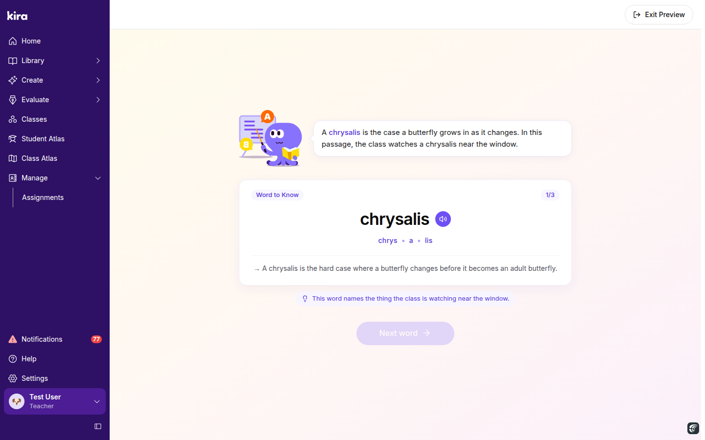

### 5. 清单外那条：字数差值不固定

**已确认**

- **怎么看**：按评论开头「走到 Step 3」的步骤，贴文字后先看 Step 2 粘贴框下的字数，再看 Step 3 任务名下面的字数。
- **差异**：评论写的是 Step 2 183 words、Step 3 184 words，差 1。11-16 换了一段文字再走，Step 2 是 180 words、Step 3 是 182 words，差 2。差值随文字变化，说明两处的数法不一样，不是固定差一个。
- **建议评论补**：“差值随文字变化（11-16 另一段为 180 / 182）”。

R1-08：创建向导 Step 2，贴完文字

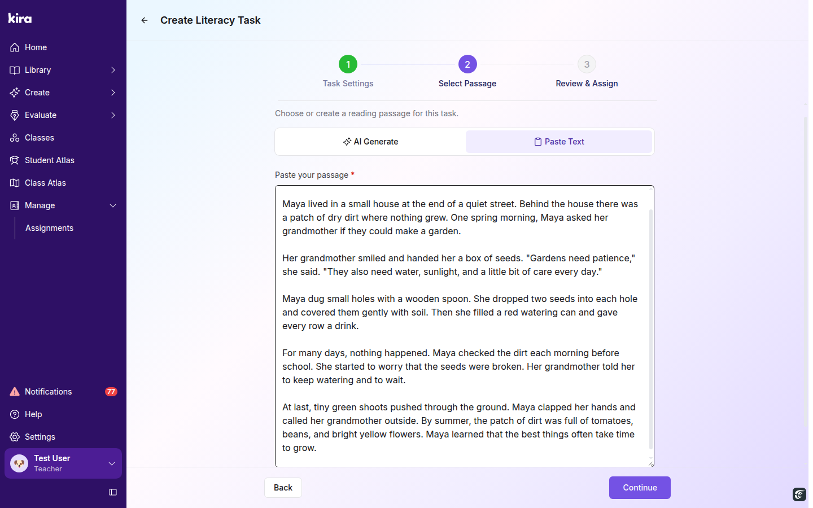

R1-09：创建向导 Step 3 Review

## 二、新问题：评论和 PR 都没有

### Quick Assign 选 Live 时的说明句不对

**已确认** · 待改

- **怎么看**：[Dashboard](https://staging.kira-learning.com/ai-tools/literacy-studio/) 点 Needs Attention 卡，翻到有 “AI Tutor” 按钮的页（11-16 在第 2 页），点任一行 “AI Tutor”，在 Mode 里点 Live，看下面那句；看完点 Cancel，不要点 Assign。
- **设计稿**：Quick Assign Step 1 · Live [`2054:18045`](https://www.figma.com/design/pCdwCN68j1KGXz3aZZ6Wn0/Literacy-Studio-AI-Tutor?node-id=2054-18045)，11-16 已是 PRD 写法。
- **问题**：staging 写的是 “You open, pause and end the practice in class. No duration or buffer.”，PRD §7.4 是 “You start, pause and end the practice in class. No time limit.”。
- **为什么 R1 漏了**：R1 只看了默认的 Scheduled，没切到 Live。
- **建议**：按 PRD 原文改。可以并进评论第 7 条，改成 “Quick Assign 两种模式的说明句都不对”。

R1-30：Quick Assign 弹窗，选 Live（11-16）

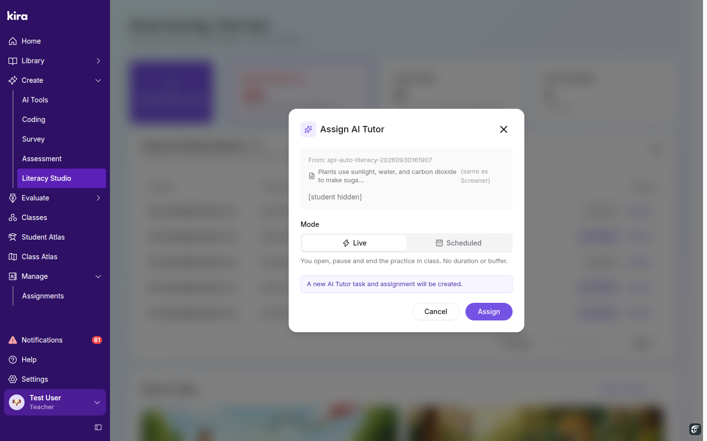

## 三、PRD 和评论不一致

### 1. 第 32 条：依据的章节号写错

**已确认**（问题本身不变）

- **差异**：评论写的是 “§4.2 Join Code”，但 PRD §4.2 讲的是 Assignment 状态，没有 Join Code。Join Code 的规则在 §5.1 Top Control Bar：“Ended: disabled, tooltip "This assignment has ended".”。
- **建议评论改**：依据改为 “§5.1 Join Code”。

R1-19：Monitor（Ended），Join Code 置灰

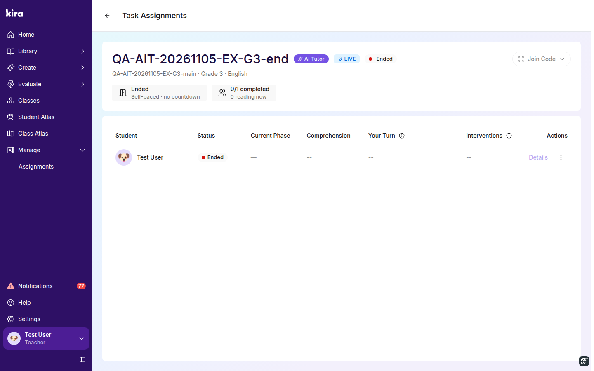

### 2. 第 5 条：漏了 Kindergarten

**已确认**

- **差异**：评论的依据写 “10-25 按年级列 6 步”。PRD §7.4 实际写的是：Grades 1–5 是 6 步；Kindergarten 是 5 步，没有 Your Turn，Guided Reading 之后直接 Oral Retelling。现在验证用的来源是 Grade 3，所以看到 6 步不受影响。
- **建议评论补**：“K 为 5 步，没有 Your Turn”。

R1-28：Reading Screener Student Detail 推荐面板

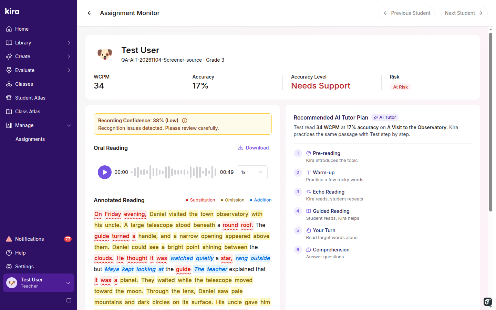

### 3. 第 13 条：一部分是 PRD 原文，应标已确认

- **差异**：评论整条标的是设计判断，但 PRD §3.2 里有两点是写死的：
  - Your Turn “Carries a "New" tag”，是原文。
  - “teachers must see at a glance that these six phases are a fixed sequence” 标的是 Product requirement（产品要求）。
  - 只有 “Fixed sequence” 标记和下面那句说明是 Reference approach（参考做法，样式由设计定）。
- **建议评论改**：“New” 标签、让老师一眼看出是固定顺序，这两点是**已确认**；具体用 “Fixed sequence” 标记加说明句，是**设计判断**。

R1-05：创建向导 Step 1，选 AI Tutor（G3）

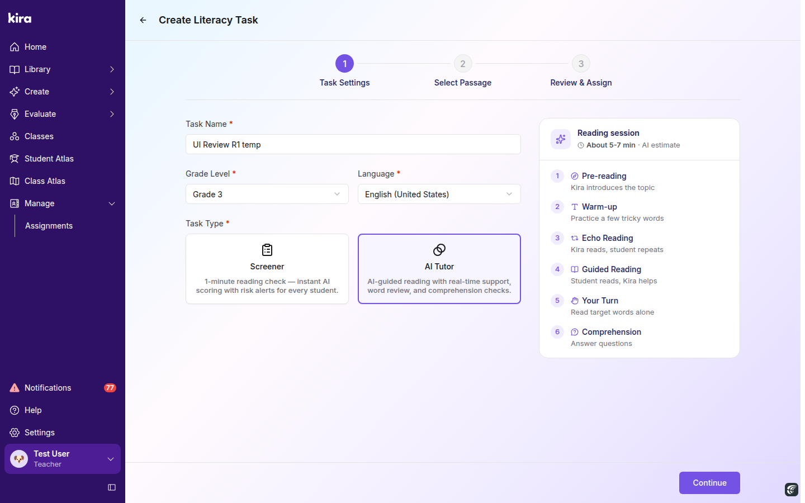

### 4. 第 3 条：三处里只有一处有 PRD 原文

- **差异**：PRD §7.4 只给推荐面板定了 “AI Tutor already assigned”。Monitor 只写了显示禁用的 “Assigned” 按钮，Dashboard 面板也没定悬停提示写什么。
- **建议评论改**：推荐面板那处是**已确认**；Dashboard 和 Monitor 的悬停提示改成同一句，是**设计判断**。

R1-01：Dashboard，悬停 “Assigned” 的提示

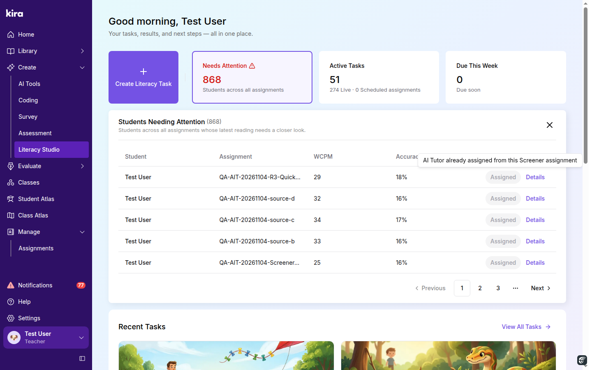

R1-27：Reading Screener Monitor，悬停 “Assigned” 的提示

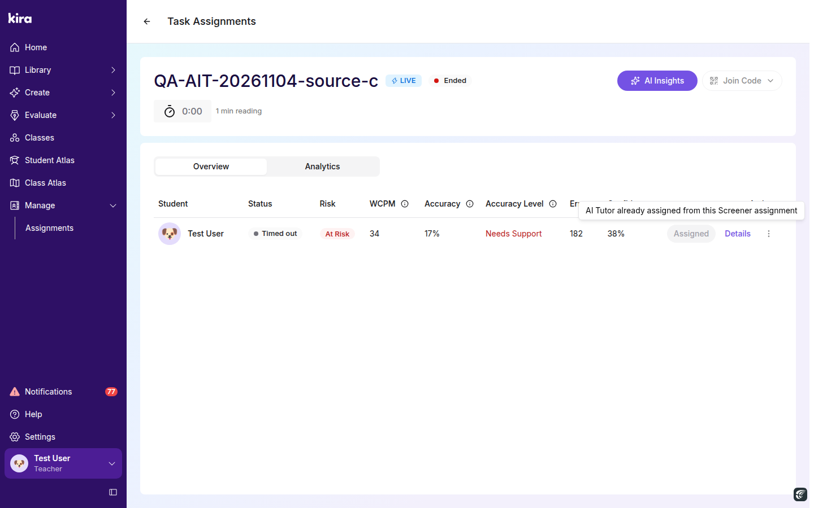

### 5. 第 4 条：Fixed sequence 标记只来自设计稿

- **差异**：PRD §7.4 写了目标词只用 “What this passage needs” 一档，文案不能暗示是按学生个人错词定制。PRD 没写推荐面板要有 “Fixed sequence” 标记，这只是设计稿里画的。评论正文说了 “设计稿里有的”，但整条标的是已确认。
- **建议评论改**：目标词和 “What this passage needs” 标签是**已确认**；“Fixed sequence” 标记是**设计判断**。

R1-28：Reading Screener Student Detail 推荐面板

## 四、PRD 自己前后不一致

这 3 处不影响评论的结论，但 PRD 要回写，或者前端改的时候要注意。

### 1. 教师标注文案：§5.4.3 和 §6.2 写法不同（第 33、38 条）

**需用户确认**（PRD 回写）

- **差异**：PRD §5.4.3 写的是 “Read it / Needed support / Can't tell”，§6.2 写的是 “Read it / Still needs support / Can't tell”。`需求文档/01_产品规则.md`（11-12）定为按 §6.2。Monitor Your Turn (i) 提示的整句，PRD 没定，只给了一个例子 “No help → Read it (teacher mark)”。
- **影响**：第 33 条按 “(teacher mark)” 改、第 38 条按 §6.2 改，都成立。PRD §5.4.3 要回写成 “Still needs support”，不然前端会照 §5.4.3 做出第三种写法。

R1-29：Monitor Your Turn 表头 (i) 提示

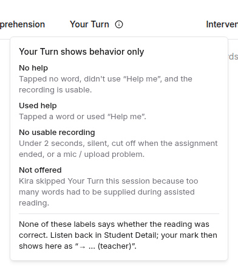

### 2. Preview：PRD §4.1 和产品规则不同（第 43、45 条）

**需用户确认**（PRD 回写）

- **差异**：PRD §4.1 还写着要显示预览横幅 “Preview Mode — Your actions won't be recorded.”，“Exit Preview” 回到 Assignment 列表。产品规则是用户 09-29 定的：不加预览条，左上 Home 换成 “← Exit Preview”。
- **影响**：评论第 43、45 条按产品规则写，用户的指示优先于 PRD，所以成立。PRD §4.1 还没回写，前端可能照 PRD 加横幅。

R1-24：Preview Intro

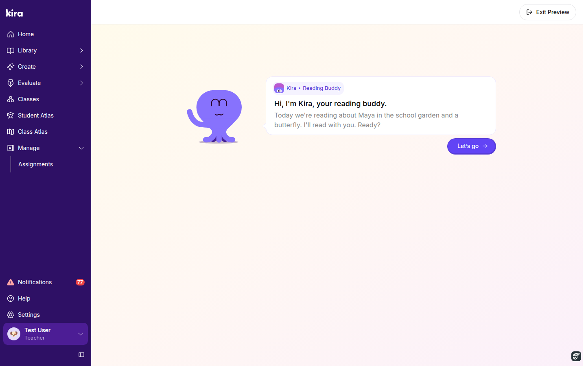

### 3. 短步骤名在别处是正式写法（第 5、12 条）

**已确认**（提醒）

- **差异**：PRD §3.4 Step 3 的标签用 “2 · Warm-up”、“6 · Comprehension”，§5.3 Monitor Current Phase 也用 “Warm-up”、“Comprehension”。只有 Step 1 步骤卡（§3.2）和推荐面板（§7.4）用全称 “Vocabulary Warm-up”、“Comprehension Check”。
- **影响**：这不算冲突，但前端改第 5、12 条时只改这两处，Step 3 和 Monitor 不要跟着改。评论可以补一句提醒。

## 五、PR #12 和评论

- **一致的**：37 条的状态、标题、截图都对得上。
- **已改的**：PR 正文第 1 条写 “Figma 同步改”，第 10 条写 “设计稿也还是旧顺序；设计稿同步”，第 33 条写 “设计稿和 staging 一样，也要改”，和同一条的状态 “11-16 设计稿已同步” 矛盾。11-16 已把 `R1_报告.md`、`R1_修改清单.md` 和 PR 正文都改成 “设计稿 11-16 已改”。
- **偏少的**：PR 结论写 “界面上至少 5 处还叫 Screener”。staging 实际可见的有 8 处：类型下拉、任务卡类型标签、Step 1 类型卡、Step 1 步骤卡标题、Quick Assign Passage 行，加上第 3 条的 3 处已分配提示；另外还有 1 处读屏说明。等评论第 1 条一起改。
- **有意不同，不用改**：
  - 第 15、20 条走到 Step 3 的步骤，PR 指向清单第 16 条，评论指向开头「走到 Step 3」，因为第 16 条没发到评论。
  - 第 33 条的建议，PR 引了 `待确认问题清单.md` 第 21 条，评论没引仓库内部文件。
  - 第 35 条的依据，PR 写 “B 轨组件一致性”，评论写 “组件一致性”。
  - PR 比评论多 14 条：需用户确认的 9 条（#2、16、18、19、22、23、28、29、47）和设计稿自身的 5 条（#9、48–51）。评论按用户要求不放。

## 等用户确认后再做

- 改评论：第 1 条位置；第 3、4、13 条分级；第 5 条补 K；第 15 条补 Step 3；第 32 条章节号；第 35、46 条和清单外那条补细节；Live 说明句并进第 7 条。
- 评论改了之后，`R1_报告.md`、`R1_修改清单.md` 和 PR 正文跟着改，三处保持一致。
- PRD 回写：§5.4.3 标注文案、§4.1 Preview 横幅。
